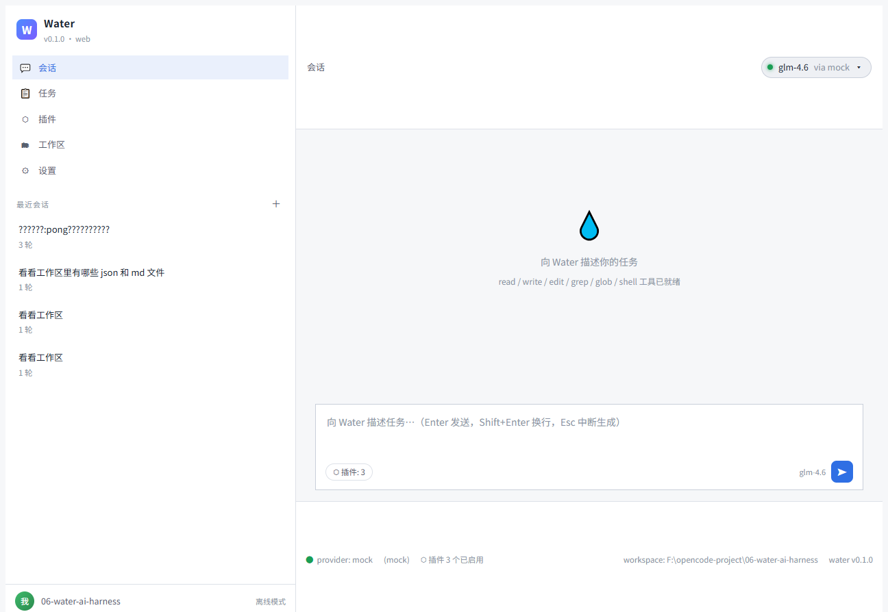
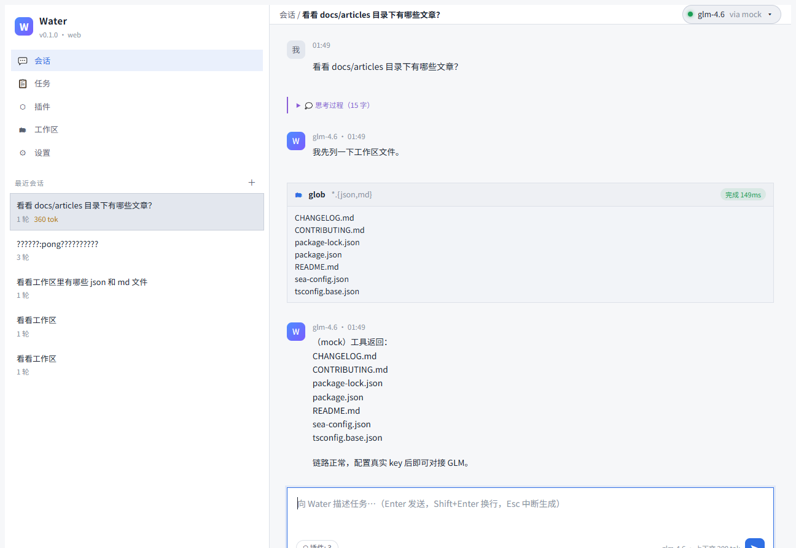
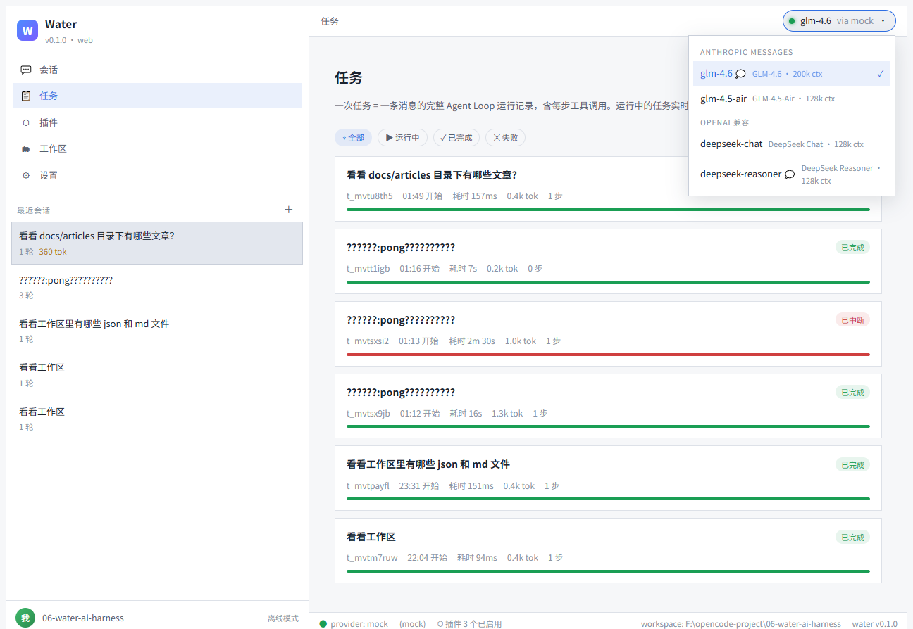
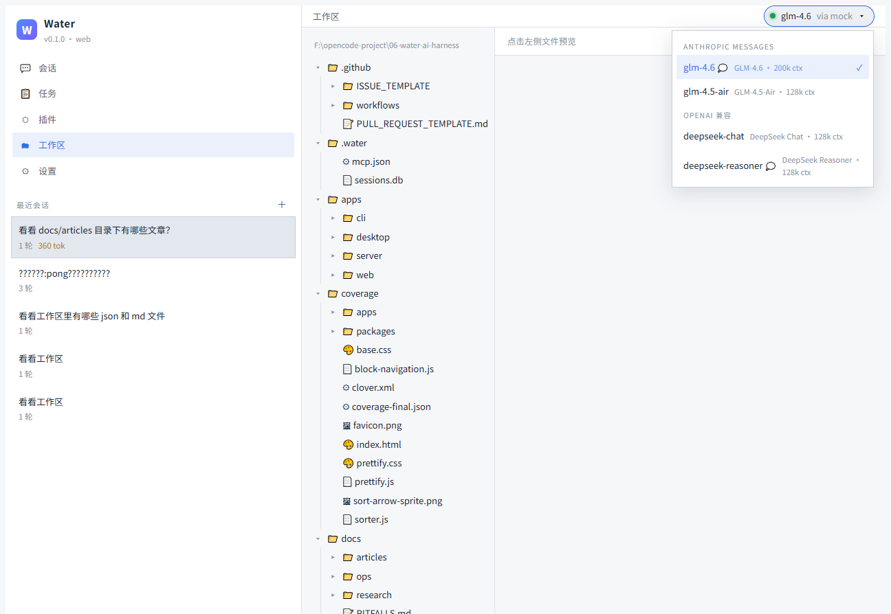
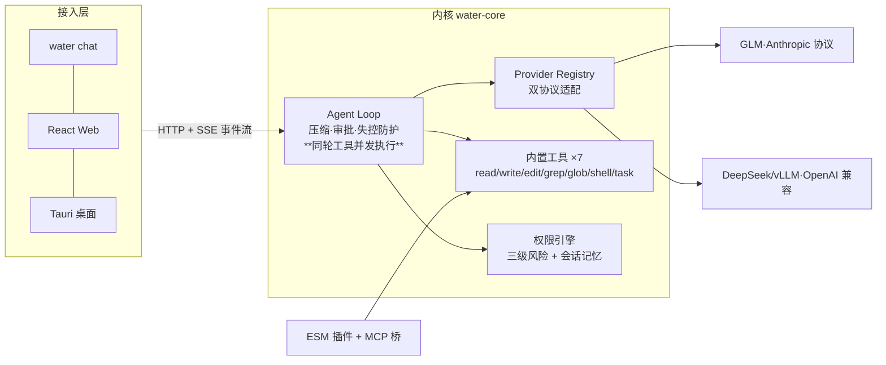

<div align="center">

# 💧 Water

**一个用于学习研究的 AI Agent Harness** —— 内核对接大模型，CLI / Web / 桌面三端，插件系统可扩展。

仿写 OpenCode / ZCode 类智能体框架：不是「又一个聊天框」，而是把
**大模型、工具、人、界面**组织进一个可循环、可扩展、可审计的运行时。

[快速开始](#快速开始) · [架构](#架构) · [学习路线](#学习路线) · [贡献指南](CONTRIBUTING.md)

</div>

---

## 快速开始（离线 mock，零凭据）

```powershell
git clone https://github.com/wsj502/water-ai-harness.git
cd water-ai-harness && npm ci
$env:WATER_MOCK='1'; npm run dev:server   # → http://127.0.0.1:3210
```

对接真实大模型（智谱 GLM / DeepSeek 等任意 OpenAI 兼容端点）：

```powershell
# 凭据经 DPAPI 加密存储注入进程内存，明文永不落盘（见 docs/articles/08）
powershell -ExecutionPolicy Bypass -File .\import-secrets.ps1 -Path <你的.env>
powershell -ExecutionPolicy Bypass -File .\start-secure.ps1 -- npx tsx apps\server\src\index.ts
```

## 界面

| 会话（工具卡 · 审批 · diff · markdown） | 模型切换（会话级，运行时生效） |
|---|---|
|  |  |

| 任务回放 | 工作区浏览 |
|---|---|
|  |  |

## 架构

```
接入层   CLI / Web / Desktop        —— 三端壳，复用同一份会话协议
协议层   HTTP + SSE（JSON 事件流）   —— 内核与前端之间的唯一契约
内核层   Agent Loop + Provider + Tool —— 模型↔工具往返调度的心脏
扩展层   Plugin System（+MCP 桥接）  —— 第三方能力的入口
```



## 功能矩阵（v0.11.0）

| 能力 | 状态 | 说明 |
|---|---|---|
| 双协议 Provider | ✅ | Anthropic Messages + OpenAI 兼容；翻译层 golden 测试帧级锁定 |
| 模型注册表与会话级切换 | ✅ | 运行时切换不重启进程；协议随模型推断；Web 只能「选」不能传 baseUrl（防 key 外泄）；**BYOK：设置页安全录入 key（只存内存/尾4位回显/白名单端点不变）** |
| **工作区注册表** | ✅ | `~/.water/workspaces.json` 多根管理；会话创建时绑定（定死不换根）；白名单防目录逃逸 |
| **会话管理** | ✅ | 删除 + 归档（可看不可发、独立列表、持久化） |
| **会话消息排队** | ✅ | busy 不再 409——按到达顺序串行的排队闸门（上限 5 → 429），`queued` 事件实时可见（写者流 + **live 观察者同帧**，M31） |
| **跨会话并行调度** | ✅ | 会话间并行、会话内串行；全局上限 `WATER_MAX_PARALLEL_SESSIONS`（默认 3），超限跨会话 FIFO 排队（`queued scope=global`）；审批桥/回放缓冲/SQLite 并发正确性有测试锁定 |
| **子代理（流式+可写+审批透传）** | ✅ | `task` 派生嵌套 Agent Loop：过程实时透传（sub_event）；`mode:write` 子级 write/edit 逐次经审批桥直达用户（callId 命名空间嵌套；无审批渠道保守拒绝零落盘）；**嵌套时间线视图**（轮次分组/缩进嵌套/状态着色，M18）；session 授权按文件粒度继承（跨子代理免重复审批，M21） |
| **LLM 摘要压缩** | ✅ | 超窗先摘要（成本披露）→ 失败回退确定性裁剪，会话绝不因压缩中断 |
| 上下文管理 | ✅ | token 估算 + 三级确定性压缩（裁旧 tool_result → 丢最旧轮次 → 孤儿清退） |
| 容错重试 | ✅ | 429/5xx 指数退避，只在流首帧前重试；中断穿透；120s 超时 |
| 权限与审批 | ✅ | 低/中/高三级风险 + **动态风险**（riskFor 按实参）；once/session/deny；审批桥打通 SSE 与反向 POST；**审批帧全量入回放缓冲 + 断开宽限期（重连不误杀，超时全拒）** |
| SSE 事件回放 | ✅ | 帧 id/seq + `?since=` 增量端点；断线补帧；刷新接上 busy 会话；**live 长连接实时推送（M29，轮询自动回退兜底）+ 排队可见性（M31：挂住排队会话/瞬时帧广播/跨轮游标/多轮单连接观察）** |
| Web 体验 | ✅ | 零依赖 markdown 渲染（XSS 架构免疫）、行级 diff、子代理过程直播、五页视图、**侧栏拖拽调宽/智能吸底/分段归档/跨页导航闭环/流式防串扰（streamGen）** |
| 三端 | ✅ | CLI（`/model` `/compact` `/system` + **子代理时间线渲染** + `--quiet`）/ Web（**live 长连接优先 + 轮询回退**）/ Tauri 桌面（SEA sidecar 单文件，**v0.10 安装包随 Release 资产交付**：冒烟 13 断言含 BYOK/live，见 #88） |
| 插件与扩展 | ✅ | 进程内 ESM + manifest 权限治理 + **MCP 多 server（mcpServers{} 业界形状）** + **配置式命令（零代码）** + **配置式声明工具（M17 prompt 型 / M22 http 型：域名白名单 + $env: 凭据插值 + high 逐次审批）** |
| SYSTEM 可配 | ✅ | env > config.json > 默认；各工作区自己的 AGENTS.md |
| 持久化 | ✅ | node:sqlite 零依赖；会话/任务/归档/工作区绑定落库重启恢复 |
| 测试 | ✅ | vitest 105 用例（协议 golden/上下文/子代理/摘要/渲染 XSS/排队闸门/子级审批/跨会话闸门/时间线折叠/配置式工具/断开宽限/CLI 时间线/授权继承[**含路径归一化**]/http 工具/**同轮并发执行**/**跨轮游标与瞬时广播**，**源码别名解耦构建产物**）+ 离线 E2E，双平台 CI |
| Docker 交付 | ✅ | 多阶段镜像 + 单进程静态托管形态；**`.dockerignore` 构建上下文 <1MB**（#65） |

## 目录结构

```
packages/core        内核：消息模型 / Agent Loop / Provider / 工具 / 权限 / 上下文管理
apps/server          HTTP + SSE 会话协议（Hono）
apps/web             React Web UI（零 markdown 依赖，XSS 架构免疫）
apps/cli             water 命令行（chat / run / doctor）
apps/desktop         Tauri 桌面端（Node SEA 单文件 sidecar）
plugins/             示例插件（echo / web-fetch / mcp-bridge）
tests/               vitest（含协议翻译层 golden 测试）
scripts/             开发脚本 + 离线 E2E
docs/articles/       13 篇深度文章（学习路线）
```

## 学习路线（docs/articles）

每推进一个阶段留下一篇「为什么这样做」的记录——代码会过时，决策过程不会。

| # | 主题 | 深挖点 |
|---|---|---|
| 00 | [导读](docs/articles/00-导读.md) | 四层架构与 P0→P6→M 系列演进逻辑 |
| 02 | [Agent Loop 解剖](docs/articles/02-Agent-Loop解剖.md) | 真实智谱 SSE 帧 / 失败模式 / 与 OpenCode 逐维对照 |
| 03 | [SSE 流式协议设计](docs/articles/03-SSE流式协议设计.md) | 三传输选型 / 审批桥 / 断线状态机 / 事件回放 |
| 09 | [模型注册表与会话级切换](docs/articles/09-模型注册表与会话级切换.md) | 为什么 Web 不能指定 baseUrl（key 外泄通道） |
| 10 | [上下文管理与容错](docs/articles/10-上下文管理与容错.md) | 压缩三级策略 / 首帧前重试纪律 / 中断语义 |
| 11 | [SSE 事件回放与可信渲染](docs/articles/11-SSE事件回放与可信渲染.md) | React 元素渲染的 XSS 免疫论证 |
| 12 | [开源工程实践实录](docs/articles/12-开源工程实践实录.md) | issue/PR/CI/tag/Release 全流程真实操作归档 |

[全部 13 篇 →](docs/articles/00-导读.md)

## 开发

```powershell
npm run typecheck          # 类型检查
npm test                   # vitest 全量单测（含协议 golden）
npm run build              # 全量构建
npm run build && npm run test:e2e   # 离线 E2E（拉起真实 server，全量断言）
```

## 路线图

- [x] P0-P6：原型 → 内核 → CLI → Server+Web → 桌面 → 插件 → 交付
- [x] v0.2.0（M0-M6）：开源工程地基 / 模型切换 / 上下文管理 / Web 体验 / 测试基建 / 文章深化 / 转公开
- [x] v0.3.0（M7-M11）：会话与工作区管理 / 只读子代理 / LLM 摘要压缩 / CLI 命令对齐 / 文章深挖第二批
- [x] v0.4.0（M12-M14）：子代理流式透传与可写模式 / 配置式命令与多 MCP / 会话消息排队
- [x] v0.5.0（M15-M18）：子代理审批透传与嵌套时间线 / 跨会话并行调度（全局并发上限）/ 配置式声明工具（配置即插件进阶）
- [x] v0.6.0（M19-M23）：审批回放统一（断开宽限期）/ CLI 子代理时间线 / 子级授权继承 / HTTP 型配置工具（白名单+凭据插值）/ 文章第三批
- [x] v0.7.0（M24-M26）：桌面端回归（SEA sidecar 重建 + 凭据判定对齐）/ 体验调优（接流轮询退避 / CLI --quiet / 授权 key 路径归一化）/ 文章补遗
- [x] v0.8.0：容器交付落地与 BYOK（dockerignore/BYOK 前端录入 key/UI 五项+导航闭环/跨会话流污染修复）
- [x] v0.9.0（M27-M28）：同轮工具并发执行（事件泵/execCtx 克隆/allSettled/env 回退）+ 02 文章补遗
- [x] v0.10.0（M29-M30）：接流长连接（live SSE 实时推送 + 轮询回退兜底 + 宽限权责分离）+ 03 文章补遗
- [x] v0.11.0（M31-M32）：live 排队可见性（挂住排队会话 / 瞬时帧广播 / 跨轮游标 / 多轮单连接观察）+ 压测工具与桌面交付工具入库 + 03 文章补遗二三

## 贡献与安全

见 [CONTRIBUTING.md](CONTRIBUTING.md)。两条红线：

- 🔐 **明文凭据永不入库**：DPAPI 加密存储 + 进程内存注入；PR 模板含凭据检查项
- 🧪 **每个变更走 issue → 分支 → PR → CI → squash merge**，main 永远可构建

## License

[MIT](LICENSE) © 2026 wsj502 · 仅供学习研究
