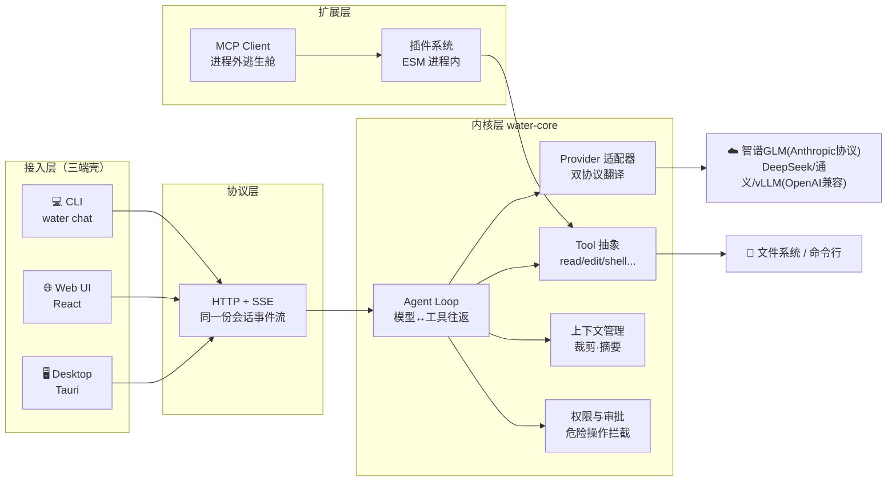
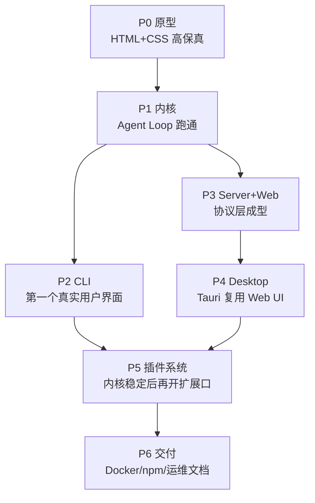

# 00 · 导读：我们要造一个什么东西

> 系列文章定位：这个项目每推进一个阶段，就留下一篇「为什么这样做」的记录。
> 代码会过时，但这些决策过程不会。读文章按编号顺序即可。

## 一句话定义

**Water 是一个 AI Agent Harness（智能体运行框架）**——它本身不生产智能，它负责：
把大模型、工具、人、界面这四者组织进一个可循环、可扩展、可审计的运行时。

## 为什么按 P0→P6 这个顺序

三条理由：

1. **UI 先行**（P0）：界面是最便宜的需求验证工具。原型阶段的每一张卡片（工具调用卡、审批卡、思考块）都对应内核里一个真实的数据结构，先把「用户看得见什么」定下来，内核的协议设计就有了锚点。
2. **内核其次**（P1）：Agent Loop 是整个项目的价值核心，必须在没有 UI 干扰的情况下把「模型↔工具往返」跑通，用 CLI 打印事件流即可验证。
3. **插件最后**（P5）：插件 API 一旦发布就难改。必须等内核、协议、三端都稳定了，才能知道插件到底需要哪些扩展点。先写 API 草案文章，再写代码。

## 各阶段文章索引

| # | 文章 | 对应阶段 | 状态 |
|---|---|---|---|
| 01 | [界面设计：从一张原型稿定下协议锚点](01-界面设计.md) | P0 | ✅ |
| 02 | [Agent Loop 解剖：模型和工具如何跳双人舞](02-Agent-Loop解剖.md) | P1 · 含 v0.6 补遗 | ✅ |
| 03 | [SSE 流式协议设计：三端共用一份事件流](03-SSE流式协议设计.md) | P1/P3 · 含 v0.6 补遗 | ✅ |
| 04 | [Node CLI 工程化与 npm 发布全流程](04-CLI工程化与npm发布.md) | P2 | ✅ |
| 05 | [三端共用一套会话协议](05-三端共用一套会话协议.md) | P3 | ✅ |
| 06 | [Tauri vs Electron：桌面端取舍](06-Tauri桌面端.md) | P4 · 含 v0.7 回归记录 | ✅ |
| 07 | [插件系统设计：隔离、权限与版本兼容](07-插件系统设计.md) | P5 · 含 v0.6 补遗 | ✅ |
| 08 | [从源码到生产：构建、镜像与分发](08-从源码到生产.md) | P6 | ✅ |
| 09 | [模型注册表与会话级切换](09-模型注册表与会话级切换.md) | M1 · 含 v0.7 BYOK 补遗 | ✅ |
| 10 | [上下文管理与容错](10-上下文管理与容错.md) | M2 | ✅ |
| 11 | [SSE 事件回放与可信渲染](11-SSE事件回放与可信渲染.md) | M3 | ✅ |
| 12 | [开源工程实践实录](12-开源工程实践实录.md) | M0-M6 · 持续更新 | ✅ |

## 版本演进（M 系列：P0-P6 之后的迭代）

- **v0.2（M0-M6）**：开源工程地基 / 模型注册表与会话级切换 / 上下文管理 / Web 体验 / 测试基建 / 文章深化
- **v0.3（M7-M11）**：会话与工作区管理 / 只读子代理 / LLM 摘要压缩 / CLI 命令对齐 / 文章第二批
- **v0.4（M12-M14）**：子代理流式+可写 / 配置式命令与多 MCP / 会话内消息排队
- **v0.5（M15-M18）**：子代理闭环（审批透传 + 嵌套时间线 UI）/ 跨会话并行调度 / 配置式声明工具（prompt 型）
- **v0.6（M19-M23）**：一致性与承诺兑现——审批回放统一（断开宽限期）/ CLI 子代理时间线 / 子级授权继承 / HTTP 型配置工具 / 文章第三批
- **v0.7（M24-M26）**：兑现三端承诺——桌面端回归（SEA sidecar 重建 + 凭据判定对齐）/ 体验调优（接流轮询退避 / CLI --quiet / 授权 key 路径归一化）/ 文章补遗

各版本的完整动机与变更见根目录 [../CHANGELOG.md](../CHANGELOG.md)；对应文章以「vXX 深化补遗」小节随版本追加，读旧文时留意文末补遗与正文的版本差。

## 贯穿全程的红线

- 🔐 凭据走 DPAPI 加密存储（`~/.ai-secrets/` 或本项目 `~/.water/`），内存注入，明文永不落盘、永不入库
- 🧪 每阶段验收标准 = **能跑起来 + 文章写完**，缺一不进下一阶段
- 📦 仓库 v0.2 起转公开：`github.com/wsj502/water-ai-harness`（MIT，仅供学习研究）
- 🕳 踩坑汇总：[../PITFALLS.md](../PITFALLS.md)（新会话先读这个）
