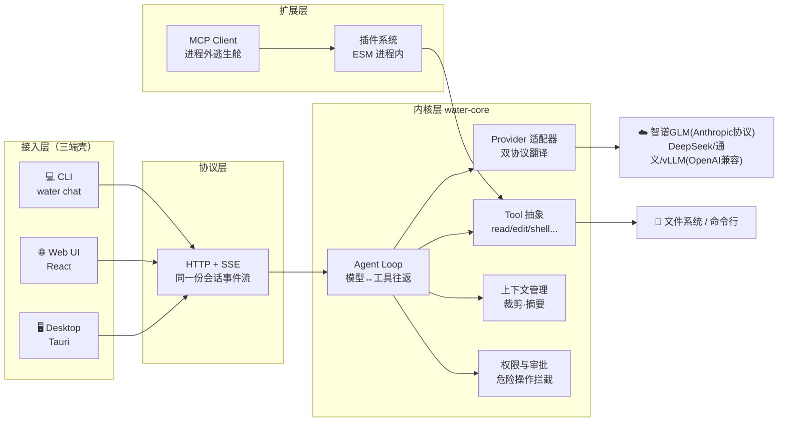
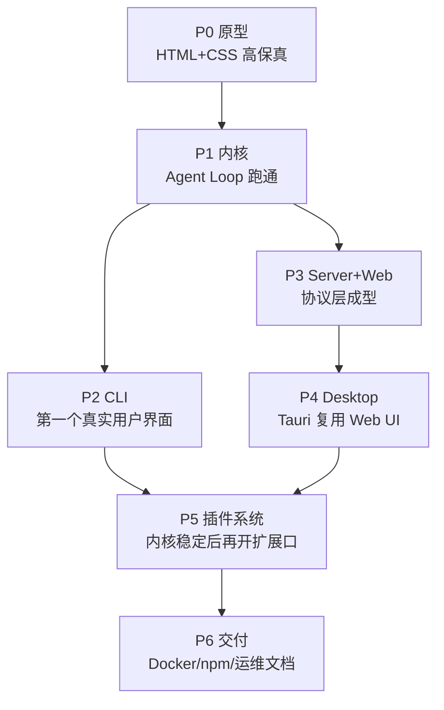

# 00 · 导读：我们要造一个什么东西

> 系列文章定位：这个项目每推进一个阶段，就留下一篇「为什么这样做」的记录。
> 代码会过时，但这些决策过程不会。读文章按编号顺序即可。

## 一句话定义

**Water 是一个 AI Agent Harness（智能体运行框架）**——它本身不生产智能，它负责：
把大模型、工具、人、界面这四者组织进一个可循环、可扩展、可审计的运行时。

## 为什么按 P0→P6 这个顺序

三条理由：

1. **UI 先行**（P0）：界面是最便宜的需求验证工具。原型阶段的每一张卡片（工具调用卡、审批卡、思考块）都对应内核里一个真实的数据结构，先把「用户看得见什么」定下来，内核的协议设计就有了锚点。
2. **内核其次**（P1）：Agent Loop 是整个项目的价值核心，必须在没有 UI 干扰的情况下把「模型↔工具往返」跑通，用 CLI 打印事件流即可验证。
3. **插件最后**（P5）：插件 API 一旦发布就难改。必须等内核、协议、三端都稳定了，才能知道插件到底需要哪些扩展点。先写 API 草案文章，再写代码。

## 各阶段文章索引

| # | 文章 | 对应阶段 | 状态 |
|---|---|---|---|
| 01 | [界面设计：从一张原型稿定下协议锚点](01-界面设计.md) | P0 | ✅ |
| 02 | [Agent Loop 解剖：模型和工具如何跳双人舞](02-Agent-Loop解剖.md) | P1 | ✅ |
| 03 | SSE 流式协议设计：三端共用一份事件流 | P1/P3 | ⬜ |
| 04 | [Node CLI 工程化与 npm 发布全流程](04-CLI工程化与npm发布.md) | P2 | ✅ |
| 05 | 三端共用一套会话协议 | P3 | ⬜ |
| 06 | Tauri vs Electron：桌面端取舍 | P4 | ⬜ |
| 07 | 插件系统设计：隔离、权限与版本兼容 | P5 | ⬜ |
| 08 | 从源码到生产：构建、镜像与分发 | P6 | ⬜ |

## 贯穿全程的红线

- 🔐 凭据走 DPAPI 加密存储（`~/.ai-secrets/`），内存注入，明文永不落盘、永不入库
- 🧪 每阶段验收标准 = **能跑起来 + 文章写完**，缺一不进下一阶段
- 📦 仓库推 GitHub 私仓，仅供个人学习研究
