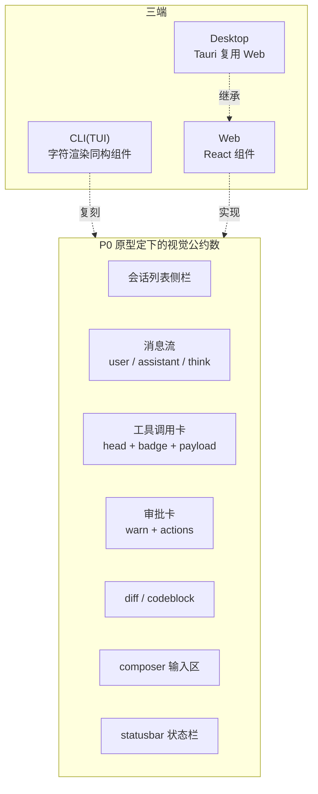
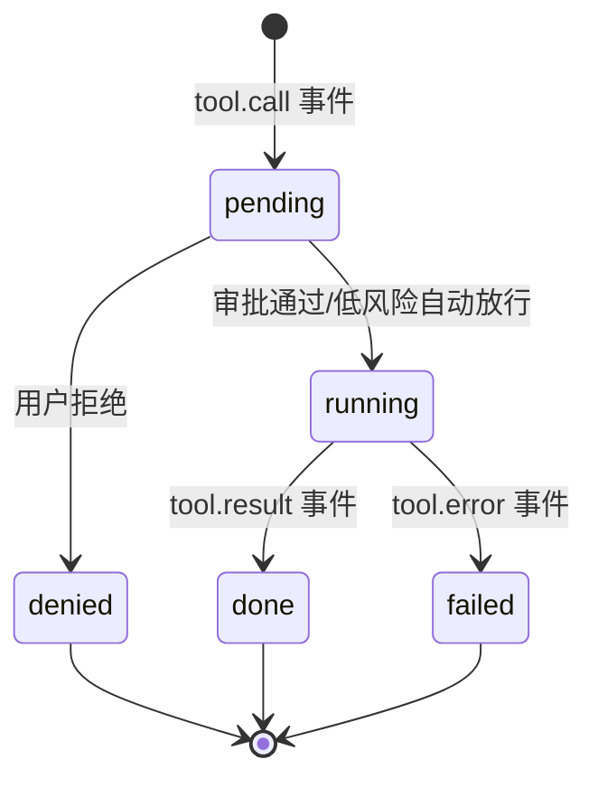
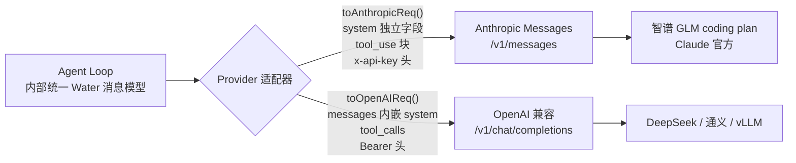
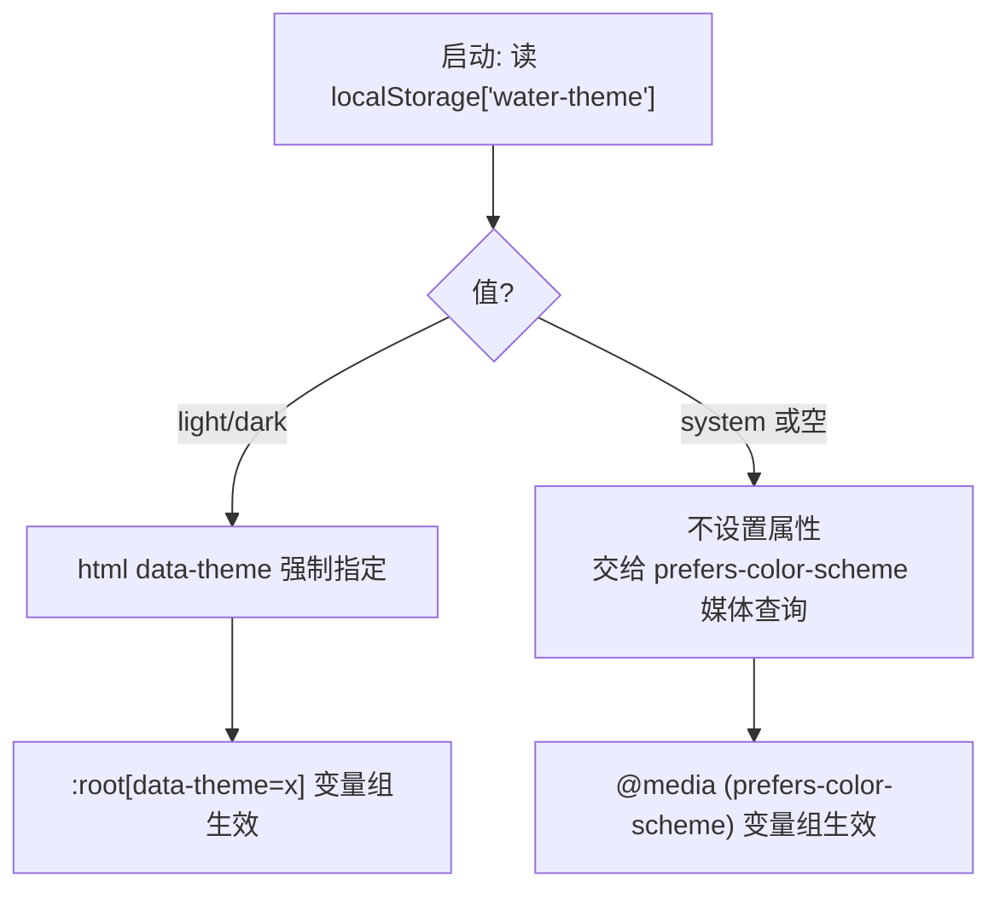

# 01 · 界面设计：从一张原型稿定下协议锚点

> 阶段：P0 ｜ 产出：`prototype/`（3 页高保真 HTML+CSS，纯静态可直接双击打开）
> 核心观点：**界面是协议的镜像**——原型里每个视觉元素，都提前对应了内核将来要发的一个事件。

## 为什么 UI 先行

Agent harness 和普通应用最大的区别：它的界面不是「表单+列表」，而是**一条正在发生的事件流**。
用户看到的一切——模型吐字、工具调用、审批请求、diff——本质上都是内核事件的投影。
所以先画 UI 的真正目的，是逼自己回答：

> 「用户在这个瞬间需要看到什么？」→「那内核就必须在这个瞬间发出什么事件。」

## 三屏一公约数

P0 原型共五页，覆盖了 harness 的全部关键交互面：

| 页面 | 文件 | 定下的协议锚点 |
|---|---|---|
| 会话主界面 | `prototype/index.html` | 消息事件、工具调用卡、审批卡、流式光标、token 计数 |
| 任务 | `prototype/tasks.html` | 任务=一次 Agent Loop 运行记录：步骤回放、进度条、中断原因 |
| 插件市场 | `prototype/plugins.html` | 插件元数据结构（名称/权限/来源/状态） |
| 工作区 | `prototype/workspace.html` | 文件树、文件预览、「在会话中引用」的上下文注入入口 |
| 设置 | `prototype/settings.html` | Provider 双协议配置模型、主题三档、行为开关项 |

## 关键设计决策（每个都对应内核的一个承诺）

### 1. 工具调用卡 = 事件的三段式生命周期

卡片头部右侧的 badge 有三个状态：`运行中 → 完成/失败 → 等待审批`。
这直接规定了内核协议里 tool 事件至少要有：

→ P1 内核的 `ToolCall` 类型必须有 `id / name / args / status / result / durationMs` 六个字段，一个不能少。

### 2. 审批卡是安全模型的 UI 表达

`允许一次 / 本会话总是允许 / 拒绝` 三档，对应内核权限系统的三种授权粒度（once / session / deny）。
设置页里「自动审批低风险工具」「shell 必须确认」两个开关，就是这套规则的默认配置。

### 3. 思考块默认折叠

推理模型（R1 类）的思考过程动辄几千 token，默认折叠、点击展开、显示耗时——
这决定了 SSE 协议里 reasoning 和 content 必须**分通道传输**，前端才能分开渲染。

### 4. 上下文计量常驻

composer 右下 `12.4k/128k` 不是装饰：它逼内核在每轮请求前统计 token，
这正是 P1「上下文裁剪与自动摘要」功能的用户可感知出口。

### 5. 插件卡片上的权限徽章

`network` / `shell` / `fs:write` 这些黄色徽章在安装前就展示——
这规定了 P5 插件系统的 manifest **必须强制声明权限**，且 UI 层在启用前可见。

### 6. Provider 双协议抽象（v2 补充）

原型设置页把「厂商协议」做成了独立下拉项，这对应内核的一个关键分层：

决策依据：智谱 coding plan 暴露的是 **Anthropic 兼容端点**（`open.bigmodel.cn/api/anthropic`），
与 Claude Code 接智谱同源。内核不绑定任何一家线协议，内部只认自己的消息模型，
翻译职责全部收敛进适配器——将来加 Gemini 也只是再写一个适配器。

### 7. 主题系统三档（v2 补充）

设置页「外观 → 主题」：深色 / 浅色 / **跟随系统**（默认）。
实现是纯 CSS 变量方案，零运行时成本：

两个要点：① 初始化脚本必须在 `<head>` 内联执行，早于 CSS 渲染，否则浅色系统下会先闪一帧深色（FOUC）；
② `color-scheme: light/dark` 同步声明，浏览器原生控件（滚动条/表单）才会跟随主题。

## 设计系统速记

- 深色调 IDE 风：`--bg-0 #0b0e14` 起，层级靠明度而非阴影
- 全文等宽字体栈（Maple Mono NF CN 优先）：中英文混排对齐，代码即正文
- 语义色克制：蓝=品牌/进行中，绿=完成，黄=等待/警告，红=危险，紫=思考
- 顶栏预留 `-webkit-app-region: drag`：P4 Tauri 阶段直接生效，零改动

## P0 验收清单

- [x] 五页高保真原型（会话 / 任务 / 插件 / 工作区 / 设置），纯 HTML+CSS，无 JS 依赖（主题切换演示脚本除外）
- [x] 原型无死链：侧栏导航全部可达，设置页菜单为页内锚点——**原型原则：所见即承诺，不放「永远不会实现」的摆设**
- [x] 设计系统 CSS 变量化，P3 React 阶段可整体平移
- [x] 每个视觉元素都标注了对应的内核事件/数据结构（本文第 2、3 节）

**下一步（P1）**：把本文定下的协议锚点变成 `packages/core` 里的真实类型，
用 CLI 打印事件流跑通第一个 Agent Loop。→ 文章 02（待写）
