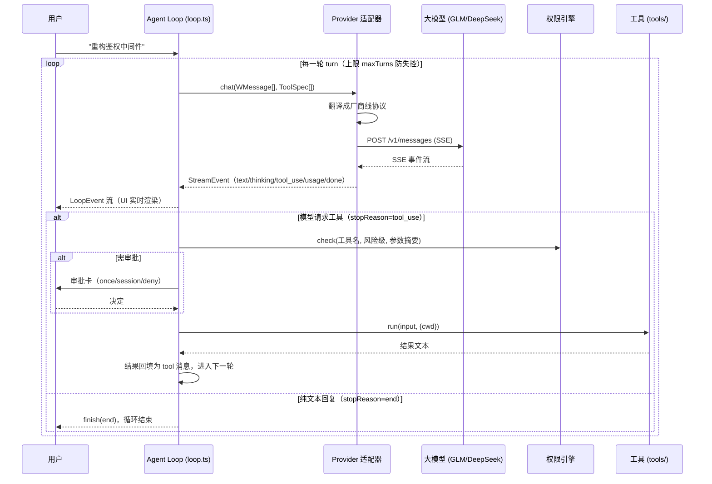
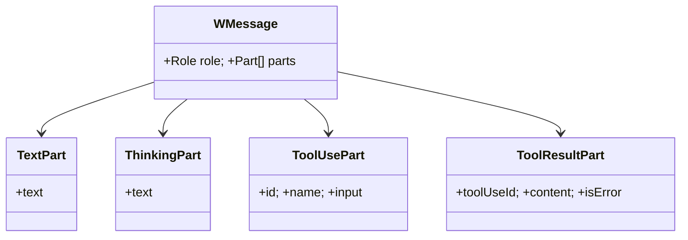
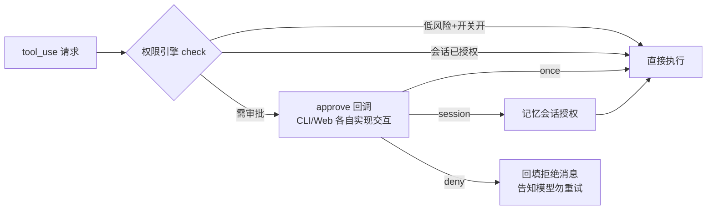

# 02 · Agent Loop 解剖：模型和工具如何跳双人舞

> 阶段：P1 ｜ 代码：`packages/core/src/`
> 本篇回答一个问题：**从用户敲下一句话，到模型改完代码，中间到底发生了什么？**

## 全景时序



## 核心设计一：Water 消息模型（types.ts）

内核不认识任何厂商协议，只认自己的消息模型。**一条消息 = role + parts[]**，
part 是可组合的块：



为什么用 parts 而不是 `content: string`？因为 Anthropic 的 content block 和
OpenAI 的 tool_calls 在结构上都是「一条消息里有多个异构块」。
parts 数组是两者的**最小公倍数**，翻译无损。

一次完整工具调用的历史长这样（离线闭环测试的真实输出）：

```
[0] system(text)                     ← 系统提示
[1] user(text)                       ← 用户输入
[2] assistant(thinking,text,tool_use) ← 模型：思考 + 正文 + 请求工具
[3] tool(tool_result)                ← 内核：执行结果回填
[4] assistant(text)                  ← 模型：基于结果给结论
```

## 核心设计二：协议差异全部收敛在适配器

| 差异点 | Anthropic Messages | OpenAI 兼容 | 适配器做法 |
|---|---|---|---|
| system 位置 | 顶层 `system` 字段 | `messages[0]` | anthropic.ts 抽出；openai.ts 内嵌 |
| 工具结果角色 | `user` 消息包 `tool_result` 块 | 独立 `role:'tool'` | 双向各自转换 |
| 工具调用格式 | `tool_use` content block | `tool_calls[].function` | 双向各自转换 |
| 鉴权头 | `x-api-key` | `Authorization: Bearer` | 构造时写死各自风格 |
| 思考通道 | `thinking_delta` 事件 | `delta.reasoning_content`（DeepSeek 约定） | 都映射为 `ThinkingPart` |
| 参数流式 | `input_json_delta` 碎片 | `function.arguments` 碎片 | 各自按 index 聚合后再发 `tool_use` |

**关键决策：思考块不回传。** 历史里的 thinking 对后续推理没有价值，还会浪费 token
（Anthropic 官方甚至要求带 signature 才能回传）。适配器在翻译历史时直接丢弃 thinking part。

## 核心设计三：权限在 Loop 内、执行前



两个细节：

1. **拒绝也是结果**：deny 不是静默丢弃，而是把「用户拒绝了，请说明如何继续」
   回填为 tool_result 发给模型——模型需要这个信号来调整策略，否则会卡在同一调用上重试。
2. **无交互渠道时保守拒绝**：`approve` 回调缺省时 ask 直接降级为 deny。
   后台任务、批处理场景下宁可不做，不可乱做。

## 核心设计四：失控防护

- `maxTurns`（默认 20）：模型陷入「调工具→报错→再调」死循环时的硬上限
- `AbortSignal`：用户 Ctrl+C / Esc 中断，直接终止流
- 工具执行 `try/catch`：工具崩了把错误文本回填给模型，让它自己想办法，而不是炸掉整个会话

## P1 验收清单

- [x] Water 消息模型类型（`types.ts`）
- [x] 双协议适配器 + SSE 解析器（`providers/`，typecheck 通过）
- [x] 六个内置工具 + 权限引擎（`tools/`、`permissions.ts`）
- [x] Agent Loop（`loop.ts`，审批/拒绝/上限/中断语义完整）
- [x] **离线闭环测试 PASS**（`scripts/loop-mock-test.ts`：MockProvider 两轮真实走查，
      历史结构断言通过）
- [x] **智谱 GLM 真实联调**（2026-10-29 通过：思考流 → glob 工具调用 → 结果回填 → 中文结论）
- [x] ~~usage 的 input_tokens 恒为 0~~（已修复：智谱在 `message_delta` 才上报真实 usage，
      `message_start` 恒报 0——适配器两处都读，见 `providers/anthropic.ts`）

## 如何跑真实联调

```powershell
# 1. 把你的智谱 key 写入一个临时 .env（一行：ZHIPU_API_KEY=xxx）
# 2. 导入 DPAPI 密文存储（导入后删掉临时 .env）
powershell -ExecutionPolicy Bypass -File .\import-secrets.ps1 -Path <临时.env路径>
# 3. 凭据注入 + 启动交互会话
powershell -ExecutionPolicy Bypass -File .\start-secure.ps1 -- npx tsx scripts/dev-chat.ts
```

**下一步（P2）**：把 dev-chat 这个脚本升级成真正的 CLI 包——commander 命令树、
`water chat` / `water run` / `--json` 输出、npm 打包发布。→ 文章 04（待写）
