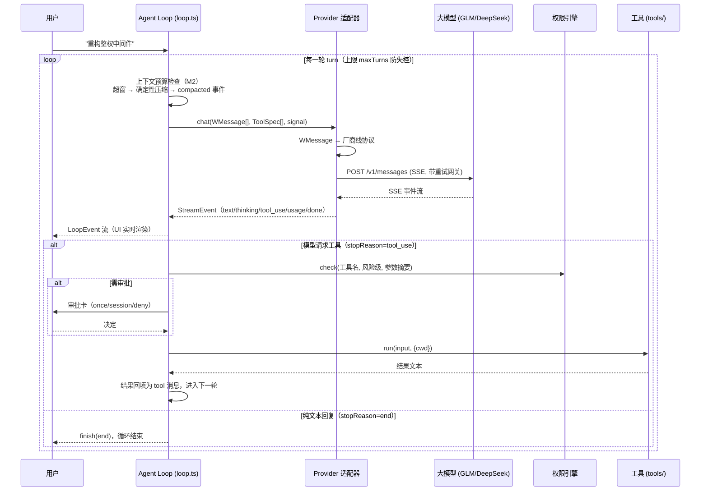
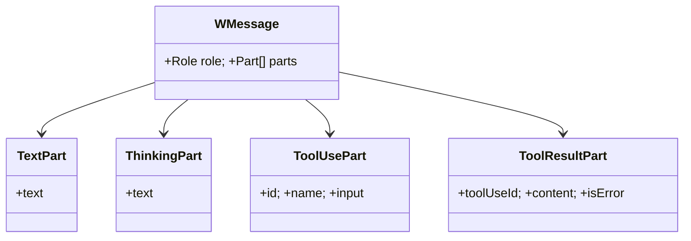
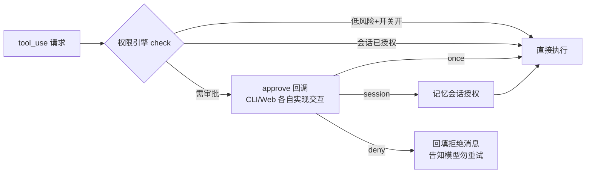

# 02 · Agent Loop 解剖：模型和工具如何跳双人舞

> 阶段：P1 起步，M1/M2 深化 ｜ 代码：`packages/core/src/loop.ts`
> 本篇回答一个问题：**从用户敲下一句话，到模型改完代码，中间到底发生了什么？**
> v0.2 版按「深挖六要素」重写：补真实帧 dump、失败模式、与 OpenCode 的对照。

## 全景时序（M2 后的最新形态）



## 一段真实的智谱 SSE 流（2026-10-30 GLM-4.6 实测，节选）

```
event: turn_start
data: {"type":"turn_start","turn":1,"model":"glm-4.6"}      ← M1：模型标识进协议

event: thinking_delta                                     ← 思考通道（英文思考是模型行为）
data: {"type":"thinking_delta","text":"The"}
data: {"type":"thinking_delta","text":" user"}

event: text_delta                                         ← 正文
data: {"type":"text_delta","text":"pong"}

event: usage                                              ← 真实计量（见下文智谱兼容坑）
data: {"type":"usage","inputTokens":67,"outputTokens":136}

event: finish
data: {"type":"finish","reason":"end"}
```

完整一次工具调用回合约 312 帧。**注意 usage 的位置**：智谱端点在
`message_start` 里恒报 0，真实值在 `message_delta`——适配器两处都读
（`anthropic.ts`，这是联调实测踩出来的厂商差异，golden 测试已锁定）。

## 核心设计一：Water 消息模型（types.ts）

内核不认识任何厂商协议，只认自己的消息模型。**一条消息 = role + parts[]**：



为什么用 parts 而不是 `content: string`？Anthropic 的 content block 和
OpenAI 的 tool_calls 在结构上都是「一条消息里有多个异构块」，parts 数组
是两者的**最小公倍数**，翻译无损（帧级证据见 golden 测试
`tests/providers.golden.test.ts`）。

一次完整工具调用的历史结构：

```
[0] system(text)                      ← 系统提示（含 AGENTS.md，M2）
[1] user(text)                        ← 用户输入
[2] assistant(thinking,text,tool_use) ← 模型：思考 + 正文 + 请求工具
[3] tool(tool_result)                 ← 内核：执行结果回填
[4] assistant(text)                   ← 模型：基于结果给结论
```

## 核心设计二：协议差异全部收敛在适配器

| 差异点 | Anthropic Messages | OpenAI 兼容 | 适配器做法 |
|---|---|---|---|
| system 位置 | 顶层 `system` 字段 | `messages[0]` | anthropic.ts 抽出；openai.ts 内嵌 |
| 工具结果角色 | `user` 消息包 `tool_result` 块 | 独立 `role:'tool'` | 双向各自转换 |
| 工具调用格式 | `tool_use` content block | `tool_calls[].function` | 双向各自转换 |
| 鉴权头 | `x-api-key` + `anthropic-version` | `Authorization: Bearer` | 构造时写死各自风格 |
| 思考通道 | `thinking_delta` 事件 | `delta.reasoning_content`（DeepSeek 约定） | 都映射为 `ThinkingPart` |
| 参数流式 | `input_json_delta` 碎片 | `function.arguments` 碎片 | 各自按 index 聚合后再发 `tool_use` |
| usage 上报 | `message_start`+`message_delta` 两处（智谱差异） | 尾部 `usage` 帧 | 各自兼容 |

**关键决策：思考块不回传。** 历史里的 thinking 对后续推理没有价值，还浪费 token
（Anthropic 官方甚至要求带 signature 才能回传）。适配器在翻译历史时直接丢弃。

## 核心设计三：权限在 Loop 内、执行前



两个细节：

1. **拒绝也是结果**：deny 不是静默丢弃，而是把「用户拒绝了，请说明如何继续」
   回填为 tool_result——模型需要这个信号调整策略，否则会卡在同一调用上重试。
2. **无交互渠道时保守拒绝**：`approve` 回调缺省时 ask 直接降级为 deny
   （tests/loop.test.ts 有专门用例）。后台任务、批处理场景下宁可不做，不可乱做。

## 失败模式分析（踩过并修掉的坑）

| 失败模式 | 0.1 行为 | 现行为 | 发现方式 |
|---|---|---|---|
| 用户中断（Esc） | **半截 assistant 消息仍入历史**，下一轮模型看到自己"话说一半" | 中断即丢弃半截消息，直接 finish(aborted) | M2 代码审查 |
| 工具抛异常 | try/catch 回填错误文本 ✅ 一直是对的 | 不变 | — |
| 429/网络抖动 | 一次失败 = 会话死亡 | 重试网关（首帧前退避重试，M2） | 真实联调偶发 |
| 上下文超窗 | provider 400，会话死亡 | 确定性压缩 + compacted 事件（M2） | 设计推演 + 强制预算测试 |
| 死循环 | maxTurns=20 硬上限 ✅ | 不变；清理了未实现的死分支 | M2 清理 |

## 与 OpenCode 的 Loop 对照（读源码笔记）

| 维度 | OpenCode | Water | 差异本质 |
|---|---|---|---|
| 审批位置 | Loop 内、执行前，permission ask | 相同 | 殊途同归——这是正确解，不是巧合 |
| 上下文管理 | compaction（LLM 摘要任务） | 确定性压缩（裁剪优先） | Water 先做可解释版本，摘要留接口 |
| 重试 | Provider 层 | 请求建立层（首帧前） | 同一纪律：不重复已产出的 token |
| 子代理 | Task 工具派生子会话 | 无（路线图） | Water 的下一步方向 |
| 中断语义 | abort signal 贯穿 | 相同 + 半截消息丢弃 | OpenCode 修复过同类 bug |

## 验证

- `tests/loop.test.ts`：两轮闭环 + 历史结构断言 + 无审批渠道保守拒绝
- `tests/providers.golden.test.ts`：翻译层帧级锁定（含智谱 usage 兼容）
- `tests/context.test.ts`：压缩三级策略 + Loop 集成（compacted 事件 + 模型视角合法性）
- 真实联调：GLM-4.6 / 4.5-air 双模型切换全程 SSE 正常（文章 09）

**下一篇**：03 讲这条事件流如何穿过 HTTP 到达三个前端。
