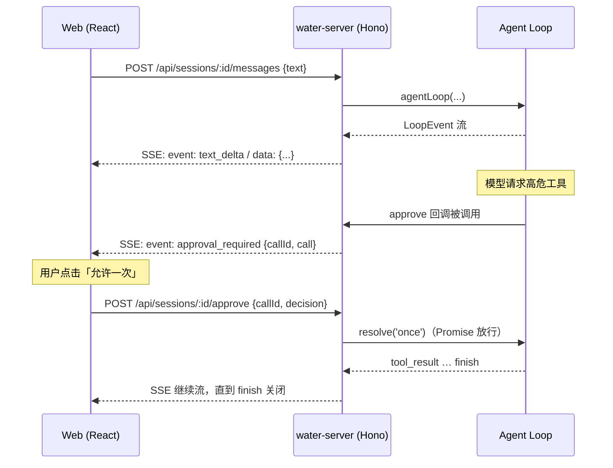
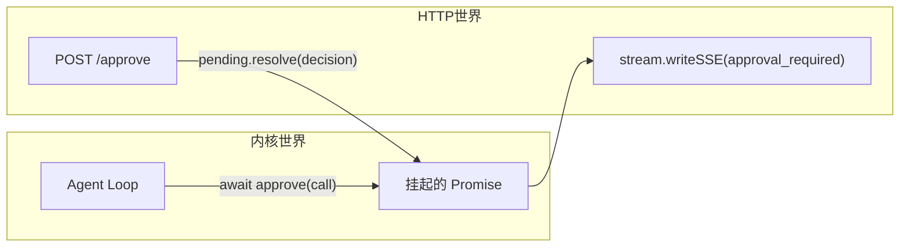
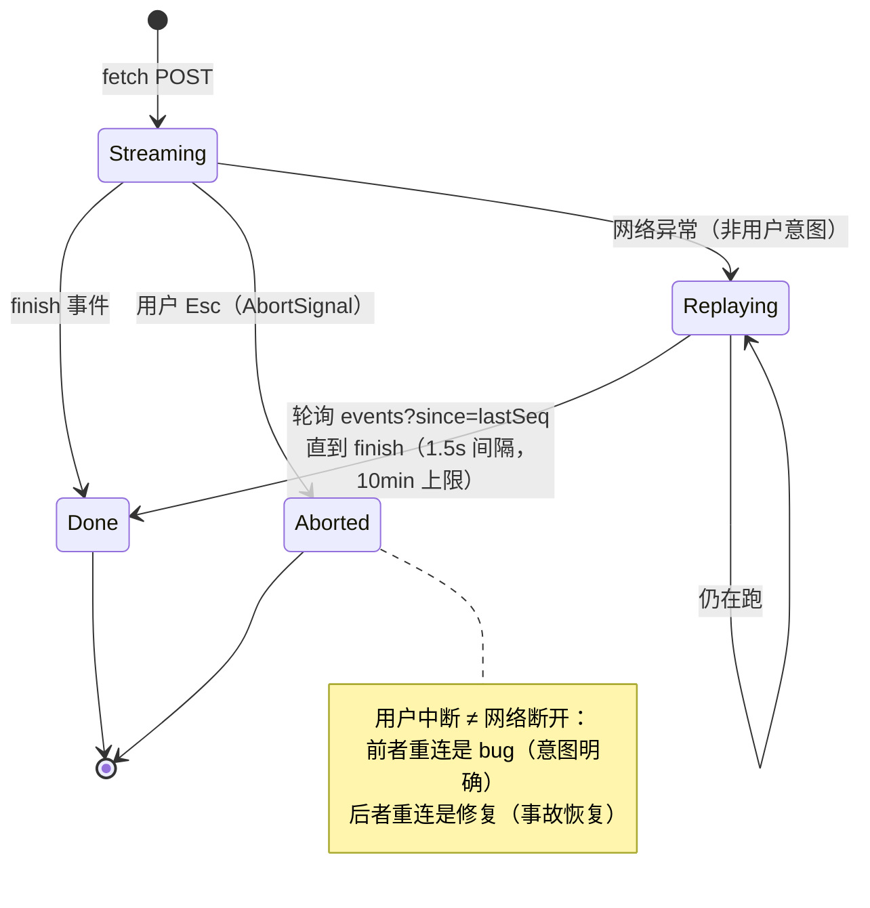

# 03 · SSE 流式协议设计：三端共用一份事件流

> 阶段：P3 起步，M1/M3 深化 ｜ 代码：`apps/server/src/index.ts`、`apps/web/src/api.ts`
> 本篇回答：**内核的事件流怎么越过 HTTP 到达浏览器，审批这种「反向操作」怎么回来，断了之后怎么接上？**
> v0.2 版补齐：帧 id/seq、事件回放端点、断线状态机、传输层选型的完整论证。

## 协议全貌



## 关键决策

### 1. 为什么 SSE 而不是 WebSocket / EventSource

| 维度 | POST + SSE（Water 的选择） | WebSocket | EventSource |
|---|---|---|---|
| 方向 | 服务端→客户端单向 | 双向 | 单向 |
| 请求语义 | POST 携带消息体，响应即流 | 需升级握手、心跳、重连协议 | **只支持 GET**，发不了消息体 |
| 审批回传 | 独立 POST（幂等、可鉴权） | 同连接回传 | 同左 |
| 断线语义 | 天然断开即终止（AbortSignal） | 需自建超时 | 浏览器自动重连（但 GET 限制） |
| 帧元数据 | 自定义解析器捕获 `id:`/`event:` | 自定义消息格式 | 原生 Last-Event-ID |

Agent 会话是**「请求-长响应」**模式：一次提问触发一条事件流。双向通信的需求只有审批回传，
而审批用普通 POST 表达更清晰（一次审批 = 一个幂等动作，有明确的状态码语义）。

EventSource 被排除的关键一条：**它只能 GET**，而发消息必须携带 JSON body。
所以 Water 用 `fetch` + `ReadableStream` 手写帧解析（`api.ts`，含 `id:` 行捕获）——
这同时带来了 M3 的回放能力：SSE 协议原生的 Last-Event-ID 语义被手动实现为
`?since=<seq>` 查询参数（见第 5 节）。

### 2. 审批桥：Loop 的 Promise 世界 ↔ HTTP 的请求世界



桥的核心是 Session 里的 `pending: Map<callId, resolver>`：

- Loop 调用 approve → 回调先往 SSE 流里**补发** `approval_required` 事件，再挂起 Promise
- 用户在前端点按钮 → POST /approve → resolver 放行 → Loop 继续 → 后续事件接着流

**兜底语义**：SSE 连接中断（关页面/断网）→ 所有悬挂审批一律 resolve('deny')。
「联系不上用户的审批」等价于「拒绝」，这是保守安全的默认。

### 3. 事件即状态：前端不做轮询

服务端事件流就是真相源（single source of truth）。
前端的 `applyEvent(blocks, event)` 是纯函数折叠器——
**UI 状态 = fold(事件序列)**，这正是 Redux/Event Sourcing 的思想：

```ts
// apps/web/src/state/blocks.ts
text_delta   → 追加到最后一个 text 块（或新建）
tool_pending → 新增 tool 块（status: running）
approval_required → 对应 tool 块转 waiting（渲染审批按钮）
tool_result  → tool 块转 done/error，附上结果
```

切换会话时走 `GET /api/sessions/:id/messages` 拉历史 WMessage[]，
用 `hydrateBlocks` 折叠成同样的块序列——**实时流和历史回放共用一套渲染**。

### 4. MVP 约束：单会话串行

`session.busy` 互斥锁：同一会话同时只允许一条消息在处理。
并发的历史交错（用户消息插进工具结果中间）会破坏 Anthropic 协议对
tool_use/tool_result 严格配对的要求——先串行，排队/中断抢占留给后续阶段。

### 5. 协议演进（M1/M3）：帧 id、事件回放与断线状态机

0.1 版的 SSE 帧只有 `event:` + `data:`。0.2 版长这样：

```
id: 1
event: turn_start
data: {"type":"turn_start","turn":1,"model":"glm-4.6"}

id: 2
event: text_delta
data: {"type":"text_delta","text":"…"}
```

三个新增语义：

1. **`id: <seq>`**——会话级单调递增序号，由 `Session.recordEvent()` 分配
   （同时写入环形回放缓冲，容量 300）
2. **缓冲按「运行」重置**——每条消息开始时清空。历史由 messages 端点
   （落库终态）负责，缓冲只覆盖"当前这一跑"的中间事件，因此
   `since=0` 就是本次运行的完整回放，与水合历史天然无重叠
3. **增量游标端点**——`GET /api/sessions/:id/events?since=<seq>` 返回
   seq 之后的事件数组与 busy 状态（E2E 断言：`since=0` 与本次运行
   SSE 事件数严格相等、seq 连续递增、`since=末尾` 为空）

前端的断线状态机（这是本协议最难写对的部分）：



刷新页面的场景走第三条路：水合历史（messages 端点）→ 发现会话 busy →
从 `since=0` 接上正在运行的事件流。**实时流、断线补帧、刷新接流——
三条路径最终都汇入同一个 `applyEvent` 折叠器**，事件即状态的架构红利。

## 端点速查（v0.2）

| 方法 | 路径 | 语义 |
|---|---|---|
| GET | /api/config | 协议/模型/工作区（无凭据） |
| GET | /api/models | 模型注册表 + 凭据就绪矩阵 + 默认（M1） |
| GET | /api/sessions | 会话列表（title/turns/busy/模型覆盖） |
| POST | /api/sessions | 新建会话（可带初始 {protocol, model}，M1） |
| PATCH | /api/sessions/:id/config | 会话级模型/协议切换，reset 清除（M1） |
| GET | /api/sessions/:id/messages | 历史水合 |
| GET | /api/sessions/:id/events?since= | 事件回放/增量补帧（M3） |
| POST | /api/sessions/:id/messages | 发消息 → SSE LoopEvent 流（帧带 id: seq） |
| POST | /api/sessions/:id/approve | 审批 {callId, decision} |

## 踩坑记录

1. **Hono `c.req.json()` 遇坏 JSON 抛异常变 500** → 已修：catch 后返回 400，附中文提示
2. **PowerShell 里 `curl -d '{"text":"中文"}'` 引号被 PS 吞掉** → 测试脚本用 `--data-binary @file` 绕开
3. **`tool_pending` 不等于「等待审批」**：低风险工具自动放行时也会发 pending。
   需要一个额外事件 `approval_required` 精确表达「Loop 正在等用户」——
   这就是为什么它不是内核 LoopEvent，而是 server 层补发的协议事件

## P3-Server 验收

- [x] curl 实测完整 SSE 周期：turn_start → thinking → tool → result → turn2 → finish
- [x] 会话列表 title 自动生成（首条消息前 30 字）
- [x] 断连兜底：悬挂审批自动拒绝
- [x] mock 模式全程可开发，无需真实 key
