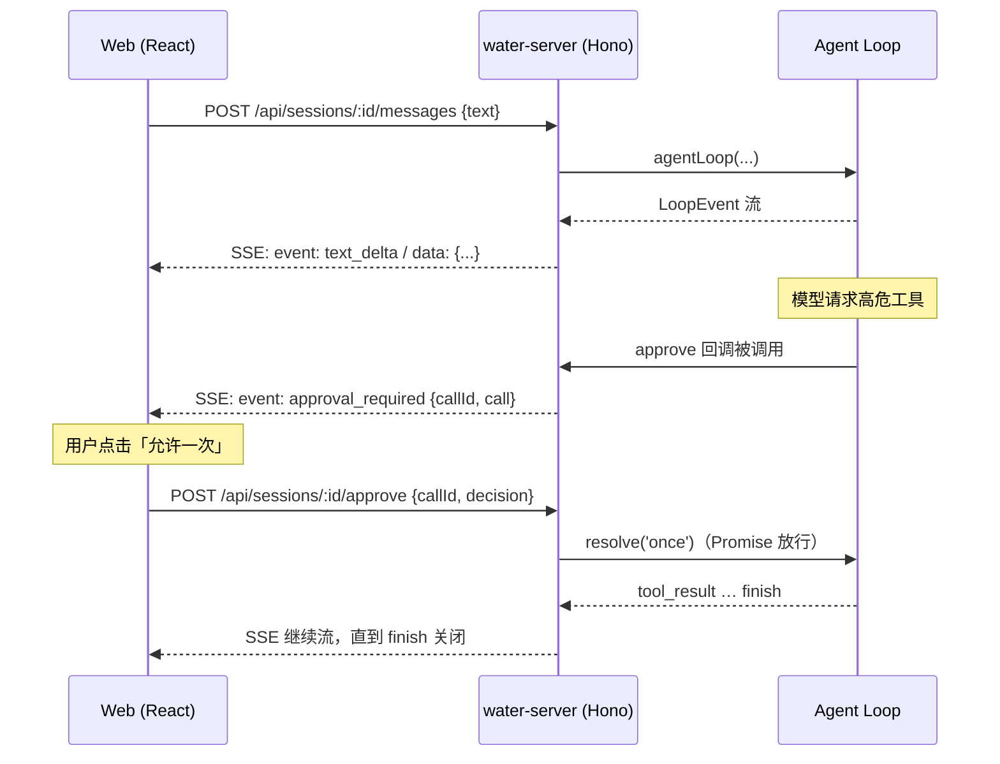
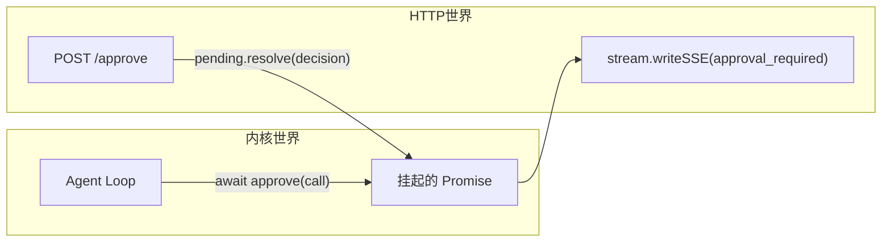
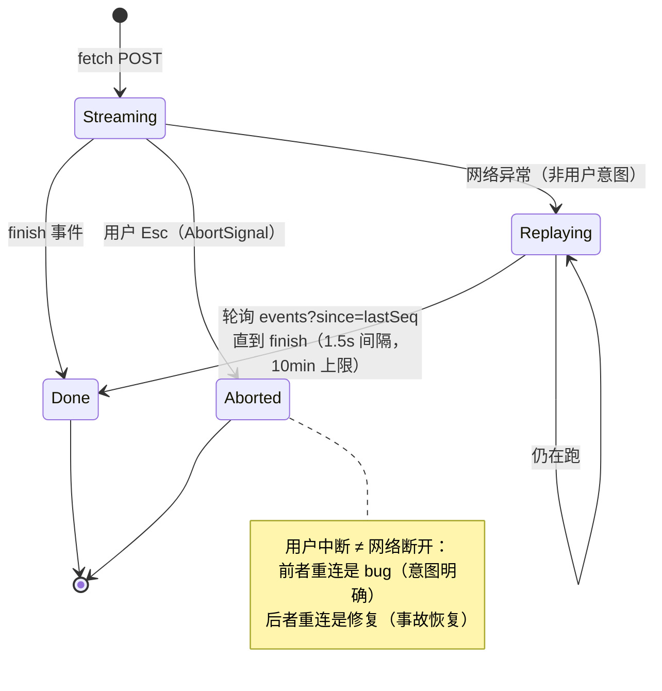

# 03 · SSE 流式协议设计：三端共用一份事件流

> 阶段：P3 起步，M1/M3 深化 ｜ 代码：`apps/server/src/index.ts`、`apps/web/src/api.ts`
> 本篇回答：**内核的事件流怎么越过 HTTP 到达浏览器，审批这种「反向操作」怎么回来，断了之后怎么接上？**
> v0.2 版补齐：帧 id/seq、事件回放端点、断线状态机、传输层选型的完整论证。

## 协议全貌



## 关键决策

### 1. 为什么 SSE 而不是 WebSocket / EventSource

| 维度 | POST + SSE（Water 的选择） | WebSocket | EventSource |
|---|---|---|---|
| 方向 | 服务端→客户端单向 | 双向 | 单向 |
| 请求语义 | POST 携带消息体，响应即流 | 需升级握手、心跳、重连协议 | **只支持 GET**，发不了消息体 |
| 审批回传 | 独立 POST（幂等、可鉴权） | 同连接回传 | 同左 |
| 断线语义 | 天然断开即终止（AbortSignal） | 需自建超时 | 浏览器自动重连（但 GET 限制） |
| 帧元数据 | 自定义解析器捕获 `id:`/`event:` | 自定义消息格式 | 原生 Last-Event-ID |

Agent 会话是**「请求-长响应」**模式：一次提问触发一条事件流。双向通信的需求只有审批回传，
而审批用普通 POST 表达更清晰（一次审批 = 一个幂等动作，有明确的状态码语义）。

EventSource 被排除的关键一条：**它只能 GET**，而发消息必须携带 JSON body。
所以 Water 用 `fetch` + `ReadableStream` 手写帧解析（`api.ts`，含 `id:` 行捕获）——
这同时带来了 M3 的回放能力：SSE 协议原生的 Last-Event-ID 语义被手动实现为
`?since=<seq>` 查询参数（见第 5 节）。

### 2. 审批桥：Loop 的 Promise 世界 ↔ HTTP 的请求世界



桥的核心是 Session 里的 `pending: Map<callId, resolver>`：

- Loop 调用 approve → 回调先往 SSE 流里**补发** `approval_required` 事件，再挂起 Promise
- 用户在前端点按钮 → POST /approve → resolver 放行 → Loop 继续 → 后续事件接着流

**兜底语义**：SSE 连接中断（关页面/断网）→ 所有悬挂审批一律 resolve('deny')。
「联系不上用户的审批」等价于「拒绝」，这是保守安全的默认。

### 3. 事件即状态：前端不做轮询

服务端事件流就是真相源（single source of truth）。
前端的 `applyEvent(blocks, event)` 是纯函数折叠器——
**UI 状态 = fold(事件序列)**，这正是 Redux/Event Sourcing 的思想：

```ts
// apps/web/src/state/blocks.ts
text_delta   → 追加到最后一个 text 块（或新建）
tool_pending → 新增 tool 块（status: running）
approval_required → 对应 tool 块转 waiting（渲染审批按钮）
tool_result  → tool 块转 done/error，附上结果
```

切换会话时走 `GET /api/sessions/:id/messages` 拉历史 WMessage[]，
用 `hydrateBlocks` 折叠成同样的块序列——**实时流和历史回放共用一套渲染**。

### 4. MVP 约束：单会话串行

`session.busy` 互斥锁：同一会话同时只允许一条消息在处理。
并发的历史交错（用户消息插进工具结果中间）会破坏 Anthropic 协议对
tool_use/tool_result 严格配对的要求——先串行，排队/中断抢占留给后续阶段。

### 5. 协议演进（M1/M3）：帧 id、事件回放与断线状态机

0.1 版的 SSE 帧只有 `event:` + `data:`。0.2 版长这样：

```
id: 1
event: turn_start
data: {"type":"turn_start","turn":1,"model":"glm-4.6"}

id: 2
event: text_delta
data: {"type":"text_delta","text":"…"}
```

三个新增语义：

1. **`id: <seq>`**——会话级单调递增序号，由 `Session.recordEvent()` 分配
   （同时写入环形回放缓冲，容量 300）
2. **缓冲按「运行」重置**——每条消息开始时清空。历史由 messages 端点
   （落库终态）负责，缓冲只覆盖"当前这一跑"的中间事件，因此
   `since=0` 就是本次运行的完整回放，与水合历史天然无重叠
3. **增量游标端点**——`GET /api/sessions/:id/events?since=<seq>` 返回
   seq 之后的事件数组与 busy 状态（E2E 断言：`since=0` 与本次运行
   SSE 事件数严格相等、seq 连续递增、`since=末尾` 为空）

前端的断线状态机（这是本协议最难写对的部分）：



刷新页面的场景走第三条路：水合历史（messages 端点）→ 发现会话 busy →
从 `since=0` 接上正在运行的事件流。**实时流、断线补帧、刷新接流——
三条路径最终都汇入同一个 `applyEvent` 折叠器**，事件即状态的架构红利。

## 端点速查（v0.2）

| 方法 | 路径 | 语义 |
|---|---|---|
| GET | /api/config | 协议/模型/工作区（无凭据） |
| GET | /api/models | 模型注册表 + 凭据就绪矩阵 + 默认（M1） |
| GET | /api/sessions | 会话列表（title/turns/busy/模型覆盖） |
| POST | /api/sessions | 新建会话（可带初始 {protocol, model}，M1） |
| PATCH | /api/sessions/:id/config | 会话级模型/协议切换，reset 清除（M1） |
| GET | /api/sessions/:id/messages | 历史水合 |
| GET | /api/sessions/:id/events?since= | 事件回放/增量补帧（M3） |
| POST | /api/sessions/:id/messages | 发消息 → SSE LoopEvent 流（帧带 id: seq） |
| POST | /api/sessions/:id/approve | 审批 {callId, decision} |

## 踩坑记录

1. **Hono `c.req.json()` 遇坏 JSON 抛异常变 500** → 已修：catch 后返回 400，附中文提示
2. **PowerShell 里 `curl -d '{"text":"中文"}'` 引号被 PS 吞掉** → 测试脚本用 `--data-binary @file` 绕开
3. **`tool_pending` 不等于「等待审批」**：低风险工具自动放行时也会发 pending。
   需要一个额外事件 `approval_required` 精确表达「Loop 正在等用户」——
   这就是为什么它不是内核 LoopEvent，而是 server 层补发的协议事件

## P3-Server 验收

- [x] curl 实测完整 SSE 周期：turn_start → thinking → tool → result → turn2 → finish
- [x] 会话列表 title 自动生成（首条消息前 30 字）
- [x] 断连兜底：悬挂审批自动拒绝
- [x] mock 模式全程可开发，无需真实 key

## v0.6 深化补遗：两级闸门与审批桥的完整状态机（M14/M16/M19）

正文写的是 v0.2 的协议骨架。此后并发与审批把它推向了完整的状态机，这条补遗按「闸门 → 审批 → 回放」三层展开。

### 一、两级闸门：会话内串行 + 会话间并行

- **M14（会话内）**：`Session.enqueueTurn` 的 promise 链闸门——同一会话的新消息按到达顺序串行，busy 不再 409；
- **M16（会话间）**：`ParallelGate`（apps/server/src/gate.ts）——limit-N 信号量 + FIFO 等待队列，上限 `WATER_MAX_PARALLEL_SESSIONS`（默认 3）。

M16 动手前先审计现状，结论值得记录：**代码里没有任何全局串行锁**——多会话并发是「碰巧能跑」，从未被设计（无上限）、从未被验证（审批桥/SSE/SQLite 无并发测试）、没有兜底。「碰巧能跑」不等于能力。并发正确性的三个结论：

1. 审批 pending、回放缓冲本就按会话实例隔离（补单测锁定既有事实）；
2. SQLite 用 `node:sqlite` 的 `DatabaseSync` **同步 API**——事务在单线程事件循环上天然串行，不存在交错窗口，无需加锁；
3. Provider 实例按 (protocol, baseUrl, apiKeyEnv) 缓存共享，per-request 无会话态。

`ParallelGate` 的三个细节（都被单测锁定）：持有者释放时槽位**直接转交**队首（不经历 active--→++ 的空窗）；排队中放弃只撤自己的号（按 grant 引用 splice，不是 shift 队首——最易写错的一处）；release 幂等。`queued` 事件加了 `scope: 'session' | 'global'` 区分两级排队。

### 二、审批桥：从瞬时事件到可回放状态机（M15/M19）

M15 先解决**粒度**：子级审批以 `${task调用id}:${子id}` 命名空间复用整条主循环审批链路（pending Map、审批端点、断开全拒）——零新端点、零协议破坏。M19 再解决**回放**：主循环 `approval_required` 也进回放缓冲（此前是瞬时事件，刷新即丢），回放出的审批卡由后续 `tool_approved`/`tool_denied` 帧收拢状态——复用 M18 时间线的折叠语义，没有第二套逻辑。

**断开宽限期**是这版最微妙的设计：回放能力与悬挂审批安全存在张力——「断开即全拒」把刷新页面也当成放弃。M19 的答案是：断开 → `beginGrace`（默认 60s）→ 期内**读取 events 回放端点即视为重连**（取消倒计时）→ 超时才中断 Loop + 全拒。配套改造：服务端全部 SSE 写经安全发送（向已断开流写帧失败不中断运行——事件始终先进回放缓冲，断开只损失实时性不损失正确性）。

### 三、回放的正确性是「折叠函数的确定性」

M18 时间线的直播/回放同构靠的是：时间线 = sub_event 帧序列的**确定性折叠**输出，不持有任何只在直播时存在的状态。测试锁定的断言是「同一帧序列两次折叠，结构完全一致」——注意是**结构**：第一版断言直接 toEqual 整个对象，被 CI ubuntu 揭示差了 1ms 的 wall-clock `ts` 字段（本地 Windows 侥幸同毫秒通过）。「同构」比结构不比钟表，这个 flaky 是测试哲学课。

### 四、E2E 怎么「证明并行」

并行行为的可观测证据很难直接抓（时间戳有抖动）。M16 的手法：两会话发需要审批的任务并**不应答审批**（各自挂在审批上占住全局槽）→ 轮询会话列表直到 busy×2 → 第三会话发普通消息必然收到 `scope=global` 的排队帧——**这帧本身就是前两者并行的证据**（上限 2 全被占才会排队）。用确定性事件替代时间测量，E2E 从此不怕慢机器。

### 顺带修掉的两个隐患

- Web busy 会话接流：旧实现每轮重放 `since=0` 且全量水合历史——多轮轮询会重复累积文本。旧语义「断开即死」下单轮就退出，从未暴露；M19 宽限期让它必现。修复：历史只水合到本次运行的最后一条 user 消息 + 递增游标逐段补帧；
- 任务 id `t_<毫秒>`：M16 并行化后两会话同毫秒完成撞 SQLite 主键（`UNIQUE constraint failed`，E2E 日志抓的现行）——id 加随机后缀（与 Session id 同模式）。

## v0.10 补遗：从轮询到推送——live 长连接（#80）

M3 时代接流用轮询是**当时的最小实现**：一个 GET 端点 + 递增游标，几十行就有了断线补帧。
M15 直播和 M19 宽限期让它逐渐变成体验天花板——M25 的自适应退避（250ms→1200ms）是治标：
有事件时 250ms 的延迟感仍在，空转时的请求轰炸只是被「退避」缓和。M29 把它换成治本：
`GET /stream?since=N` 长连接，服务端有事件就推，客户端零延迟收到。

### 设计的三个关键选择

1. **观察者模式做分发**：`recordEvent` 本就是事件进回放缓冲的唯一入口——订阅机制挂在它身上，
   live 端点只是又一个订阅者。POST 流（写者）的发送逻辑一行未动；
2. **非 busy 补完即关，busy 保持连接**：刷新页面的存量补帧语义不变（拉完就关不占连接）；
   运行中则保持到 finish 帧。15s keepalive 注释帧防代理空闲断开；
3. **宽限触发权只在写者**：live 连接建立算「重连信号」（取消宽限倒计时），但 live 断开
   **不触发**宽限——一个会话多个观察者合法（多标签页），关一个页面不该影响运行。
   观察者断开与写者断开的语义分离，是这版最重要的协议判断。

### 翻车：连接关闭与尾帧写入的竞态

首版 live 在收到 finish 时同步关闭连接——E2E 抓到「9 帧但没有 finish」：帧的 SSE 写入是
异步的，订阅回调里同步 `done()` 会让连接先于最后一帧的写入关闭。修复：**finish 帧写入
完成的 Promise 才触发收尾**，watchdog 兜底也延迟一拍。教训：**流式协议里「发完了」和
「写完了」是两件事**，关闭时序必须锚定在写入完成而非事件到达。

### 回退链的诚实

Web 端 live 失败/提前 EOF 一律回退 M25 轮询（`/events` 端点原样保留）——长连接不是银弹，
代理、防火墙、负载均衡器都可能杀闲置连接（keepalive 只能缓解）。双层结构让体验上限提高
（零延迟）而可靠性下限不变（最坏回到 250ms 轮询）。

## v0.10 补遗·二：live 多客户端实测（#90，2026-11-01）

M29 上线时只有设计论证。压测脚本 `scripts/live-load.ts`（mock 离线、可复现）补上行为数据：

### 实测数字（本机，mock RTT 800ms，Windows）

| 场景 | 结果 |
|---|---|
| 20 观察者错峰挂载（since 混合 0 / 中途 seq） | 全员收齐同 max seq + finish；首帧延迟 p50 **4ms** / max 17ms；**finish 到达离散度 10ms** |
| 忙中途掐线 3/8 观察者（模拟代理杀连接） | 写者照常完成——**宽限未触发**（观察者/写者分离的直接实证）；幸存者零影响 |
| 掐线者带 `since=lastSeq` 重连 | 补帧恰好衔接：首帧 seq = lastSeq+1，**无缺无重** |
| 5 会话齐发（默认上限 3）× 各 2 观察者 | 全部完成；2 个写者流含 `queued` 帧（与排队数一致） |
| RTT 16s（轮次间静默 ~16s > 15s） | 观察者实收 ping **2 个**——keepalive 不只是设计 |

扇出公平性（10ms 离散度）的来源：`recordEvent` 同步遍历订阅者 Set，每个 live 连接持
**独立游标**从共享回放缓冲拉增量——没有每连接队列，也就没有队头阻塞；单个订阅者故障
被 try/catch 隔离，不拖垮记录。

### 两个语义发现（首版期望写错才看见的——修期望而非改产品）

1. **`queued` 是写者流专属的瞬时事件**：不进回放缓冲（server 明注「不属于本次运行的事件序列」），
   因此 live 观察者**永远看不到排队状态**——排队期 session 不 busy，live 按「非 busy 补完即关」
   秒关。真实影响：第二个标签页盯着排队会话时，只能靠轮询兜底的 `busy` 字段看见等待。
   是否让 live 挂住排队会话（「即将运行」状态推送），留给 v0.11 讨论；
2. **挂载与 busy 建立有竞态窗口**：观察者挂载早于运行开始 → 秒关零帧（同上语义，非错误）。
   客户端应把「live 秒关」当正常信号处理（回退轮询），而非当作故障。

### keepalive 与代理空闲超时的数学

15s keepalive ⇒ 任何**空闲超时 >15s 的中间层**都安全（每 15s 一个注释帧重置其空闲计时）；
nginx 默认 `proxy_read_timeout 60s` 天然安全。需要警惕的是 <15s 的激进配置——那正是
「代理杀长连接」的领域，Web 端轮询回退为此存在。

## v0.10 补遗·三：live 排队可见性（M31，#92，v0.11.0）

补遗·二发现的缺口（「live 观察者永远看不到排队状态」）在 M31 收口。三个决策记录：

### 1. 事件分两类，而不是把瞬时事件塞进回放

旧定案「queued 不进回放缓冲」在 M31 依然成立——它是**对的**，缺的是别的东西。事件从
此显式分两类：

| 类别 | 例子 | 通道 | 帧形态 | 语义 |
|---|---|---|---|---|
| 回放事件 | turn_start/text_delta/tool_use/finish | `recordEvent` → 回放缓冲 + `subscribe` | 有 seq id | 属于某一次运行，可补帧、可重放 |
| 瞬时事件 | queued | `emitTransient` → `subscribeTransient` | **无 id** | 状态信号，不属于任何运行，错过即错过 |

live 观察者缺的是第二类的广播机制。如果把 queued 塞进回放缓冲会怎样？缓冲「只覆盖当前
这一跑」的语义被破坏（排队的消息不是这一跑的事件），断线补帧会把别的轮次的排队状态重放
给不相干的观察者。**加一个通道，比改一个不变量便宜。**

排队期挂载的观察者没赶上 enqueue 瞬时帧——服务端在挂住时补发一帧当前排队状态
（`position` 为当下等待数，语义是近似值，如实文档化）。

### 2. 跨轮游标：多轮观察暴露的隐藏耦合

「缓冲每轮重置、seq 从 1 重计」（M3 的定案）与「客户端持游标增量拉取」之间有一个从未被
触发的耦合：**跨轮的游标是陈旧的，且永远追不上**（since=10，新轮 seq 只到 8 → 过滤后为空，
之后也不会再有 seq>10）。M29 单轮观察（finish 即关）掩盖了它；M31 多轮 hold 一上来就是
正确性问题——观察者持第一轮的游标，第二轮一帧都收不到。

修法：`eventsSince` 里 `since > 当前 seq` 只可能来自上一轮（同轮内 seq 单调，不可能超过），
判定为陈旧游标 → 返回当前轮全量。这一个规则同时修好三件事：live 多轮观察的 flush、
`/events` 轮询回退断线跨轮补帧拿空、重连 live 时的存量补帧。**一个语义修正替代三处特判。**

### 3. 挂住条件的边界清单（如实）

- 挂住：`busy || 等待数>0`；收流锚定「finish 写入完成 && 队列空」双条件（写入完成的检查
  时点在 Promise then 里，顺带缩小与「finish 后新消息入队」的竞态窗口）
- watchdog 兜底：busy 与队列都空（含订阅信号丢失 / 排队者中途放弃）延迟一拍收流
- **排队中 abort 不广播**：排队消息的客户端断开后，写者流收 finish(aborted)，观察者不收
  （瞬时事件最小集）——观察者只见队列排空后收流。是权衡不是疏漏，如实记录
- Web 端零改动：解析器本就容忍无 id 帧（frameId undefined）、queued 事件已有渲染、
  applyEvent 天然支持多轮——M29 实现时的「帧格式与 POST 流逐帧一致」承诺在此兑现红利

### 实测（live-load S5 + E2E 第 20 节）

同会话连发两条：单连接收两次 finish + 1 帧无 id 瞬时 queued + 第二轮 seq 从 1 重计无缺帧；
排空后用上一轮游标查 `/events` 得当前轮全量（4 帧，非空）。

