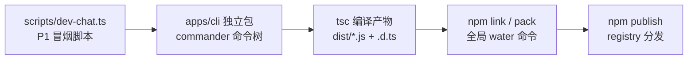
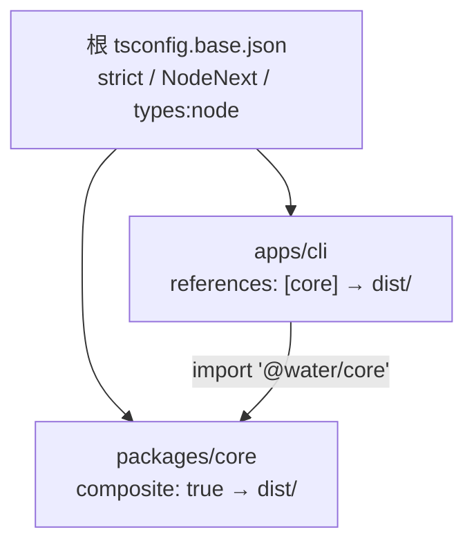

# 04 · Node CLI 工程化与 npm 发布全流程

> 阶段：P2 ｜ 代码：`apps/cli/`
> 本篇回答：**一个 TypeScript monorepo 里的 CLI，怎么从「能跑」变成「能分发」？**

## 从脚本到产品：四个台阶



P1 的 `dev-chat.ts` 能跑但有三个产品级缺陷：没有命令树（改代码才能换行为）、
直接跑 TS 源码（依赖 tsx，不能全局安装）、配置写死。P2 逐一解决。

## 决策一：monorepo 内的编译拓扑（tsc project references）



三个关键配置，每个都有坑：

| 配置 | 作用 | 踩坑记录 |
|---|---|---|
| `composite: true` | 让包可被 `tsc -b` 增量构建、被引用 | 必须配 `declaration: true` |
| `exports: { types → dist/index.d.ts, default → dist/index.js }` | 消费方拿到类型 + 运行时 | 指 src/*.ts 则 npm 包无法被纯 node 用 |
| `types: ["node"]` | 显式引入 node 类型 | 不加会报 `TS2591: Cannot find name 'node:fs'`（本项目真实踩过） |

构建命令统一为 `tsc -b packages/core apps/cli`——`-b` 模式按依赖图拓扑排序、增量编译。

## 决策二：bin 入口与 shebang

```jsonc
// apps/cli/package.json
{ "bin": { "water": "./dist/index.js" } }
```

```ts
// dist/index.js 第一行（src/index.ts 顶部声明，tsc 原样保留）
#!/usr/bin/env node
```

`npm link` 时 npm 在全局 bin 目录创建 `water` 的 shim（Windows 上是 `water.cmd`），
指向这个 dist 文件。shebang 告诉系统用 node 执行——**没有 shebang 的 bin 在 POSIX 上会以 shell 解析直接炸掉**。

## 决策三：配置四级优先级

```
命令行 flag > 环境变量 > ~/.water/config.json > 协议内置默认
```

实现就 30 行（`config.ts`），但有一条红线硬编码在加载器里：

> `config.json` 出现任何匹配 `/key|token|secret/i` 的字段直接报错退出。
> 凭据永远只走环境变量（DPAPI 注入），配置文件里出现 key 一定是事故。

协议默认值表让 `water chat` 零配置起步：选 `anthropic` 就是智谱 GLM 端点，
选 `openai` 就是 DeepSeek 端点，`--base-url` 随时覆盖。

## 决策四：--json = NDJSON 事件流

`water run "<task>" --json` 把 LoopEvent 逐行输出为 NDJSON：

```ndjson
{"type":"turn_start","turn":1}
{"type":"tool_pending","call":{"name":"grep",...}}
{"type":"tool_result","result":"...","durationMs":8,...}
```

为什么不是最终输出一个完整 JSON？因为**事件流的价值在于实时性**——
管道下游（CI 脚本、未来的 Web 端）可以在审批请求出现的第一时间响应。
NDJSON（每行一个 JSON）是流式数据的事实标准，`jq`/`Select-String` 都能直接消费。

## npm 分发全流程（实测记录）

```powershell
npm link                          # 开发期：全局 water 指向本仓库
water --version                   # → 0.1.0 ✓
npm pack --dry-run                # 发布前必跑：检查 tarball 内容
npm publish --access restricted   # 私仓/受限发布（本项目为学习用途不公开发布）
```

`pack --dry-run` 的输出值得逐行看：tarball 里应该**只有 `dist/` + `package.json`**。
源码、测试、tsconfig 都不该进去——`files: ["dist"]` 白名单比 `.npmignore` 黑名单可靠。

### workspace 依赖的发布陷阱

`apps/cli` 依赖 `@water/core: "*"`。公开发布时这要求 core 也发布到同一 registry，
否则用户 `npm i water-harness` 时解析不到 `@water/core`。三条出路：

1. **两个包都发布**（pnpm/changeset 的标准姿势）——本项目私仓路线选这个
2. **打包时内联 core**（esbuild/tsup bundle 进 dist）——单文件分发，P6 Docker 会用类似思路
3. `bundledDependencies`——已过时，不推荐

## P2 验收清单

- [x] `water chat / run / doctor` 三个命令，全局 flag（--protocol/--base-url/--model/--cwd）
- [x] 四级配置解析 + 凭据红线（config.json 禁存 key）
- [x] `--json` NDJSON 事件流
- [x] `npm link` 全局安装实测通过，`npm pack --dry-run` 产物干净
- [x] doctor 实测：智谱端点连通性 HTTP 200 · 1.6s

**下一步（P3）**：Server + Web——内核前面已经有 CLI 一个消费者了，
现在加第二个消费者（HTTP+SSE 服务），验证「三端共用内核」的架构假设。→ 文章 03/05（待写）

## v0.3 深化补遗：命令对齐与 readline 丢行坑

**M10 后 CLI 的完整形态**：`/model`（注册表清单+切换）、`/compact`、`/system`、`/help`，
未知命令显式拦截——与 Web 端命令语义一一对应（同一套注册表与预算规则）。

**踩坑实录（值得每个写 Node CLI 的人知道）**：`rl.question()` 只消费注册之后到达的
line 事件。交互式使用无感（人打字永远比提问慢），但管道/文件 stdin 下，两次提问
之间到达的行**直接蒸发**——表现为"只处理第一条命令"。修法：事件驱动 + 行缓存队列
（见 `chat.ts` 的 ask 实现）。测试 CLI 的标准姿势：`commands.txt | node dist/index.js chat`。

**双形态取舍**：npm bin（跨平台、需 Node 环境）与 SEA 单文件 sidecar（桌面端内嵌、
免运行时）。CLI 包体小走 bin，桌面端走 SEA——同一份代码两种交付，构建脚本各司其职。
