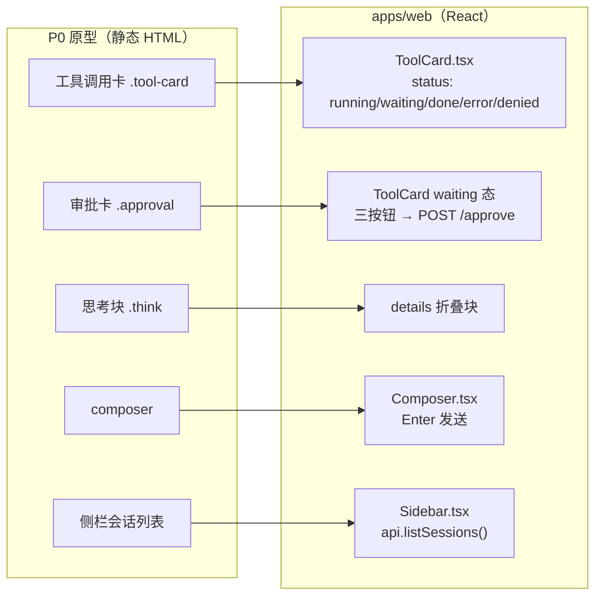
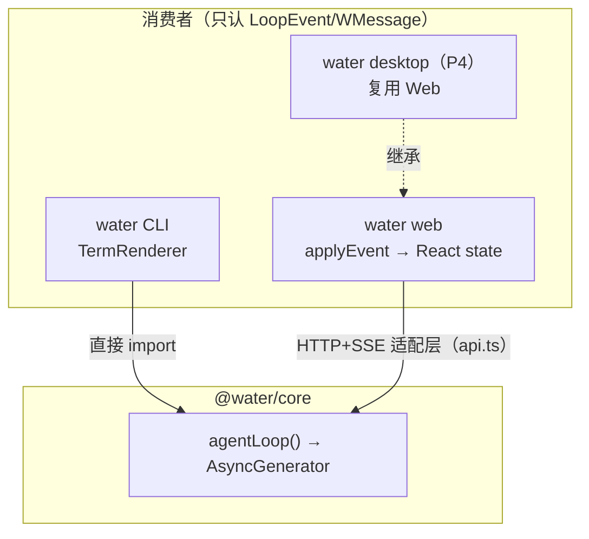

# 05 · 三端共用一套会话协议：Web 端落地记

> 阶段：P3 ｜ 代码：`apps/web/`
> 本篇回答：**P0 原型怎么变成真前端，以及「协议先行」省了多少事。**

## 从原型到产品组件的映射



P0 的回报在此兑现：`water.css` **原样复制**进 React 应用，类名一个没改；
视觉验收标准就是「和原型截图对比无差异」。

## 架构验证：CLI 和 Web 是内核的两个平等消费者



CLI 直接 import 内核函数；Web 隔了一层 HTTP+SSE。
**两层适配器（线协议适配器 + 传输适配层）是同构思想的两次应用**：
内核永远只产出 LoopEvent，怎么翻译给外界是适配层的事。

## 前端唯一有点技术含量的三件事

### 1. POST 的 SSE 读取

`EventSource` 只支持 GET，发消息必须 POST，所以手写流解析（`api.ts`）：
`fetch` → `response.body.getReader()` → 按 `\n\n` 切帧 → 拼 `data:` 行 → JSON.parse。
三十行代码，这就是 SSE 客户端的全部秘密。

### 2. 事件折叠成 UI 状态

`applyEvent(blocks, event)` 纯函数（`state/blocks.ts`），React 里：

```ts
await api.streamMessage(sid, text, ev => setBlocks(bs => applyEvent(bs, ev)));
```

React 的不可变 state 哲学和事件溯源天作之合：每次 setState 都是一次 fold。
**历史回放（hydrateBlocks）与实时流（applyEvent）产出同一种块序列**，
渲染层完全不用关心数据来自哪里。

### 3. 审批按钮的乐观 UI

点「允许一次」后本地立即 `decided=true`（按钮消失），失败才回滚——
SSE 流里的 `tool_approved/tool_denied` 事件随后到达，把块状态钉死。
两个状态源（本地乐观 + 事件流确认）以事件流为准。

## 实测记录（mock 模式）

```
浏览器: http://localhost:5173（vite dev，/api 代理到 3210）
server: WATER_MOCK=1 tsx apps/server/src/index.ts
操作: 输入「看看工作区里有什么」→ 发送
结果: ✅ 用户消息 → 工具卡 glob 完成 11ms → 模型结论文本
      ✅ 侧栏出现会话「看看工作区里有什么 · 1 轮」
      ✅ 顶栏 pill: glm-4.6 via mock
```

## P3-Web 验收

- [x] React 19 + Vite 6，typecheck 通过
- [x] SSE 流式渲染（文字逐 token 出现）
- [x] 工具卡五态（running/waiting/done/error/denied）+ 审批三按钮
- [x] 会话切换历史水合
- [x] 主题系统继承 P0（localStorage + prefers-color-scheme）
- [ ] GLM 真实联调（等 key）
- [ ] 任务/插件/工作区/设置页（P0 原型已有视觉基准，Web 化留作后续迭代）

**下一步（P4）**：Tauri 桌面端——把 `apps/web` 整个塞进 Rust 壳，
sidecar 拉起 server，系统 WebView 渲染。→ 文章 06（待写）
