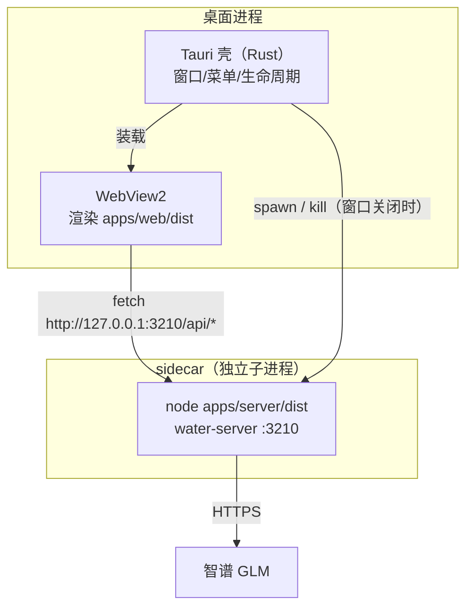

# 06 · Tauri vs Electron：桌面端取舍与 sidecar 架构

> 阶段：P4 ｜ 代码：`apps/desktop/`
> 本篇回答：**桌面端壳怎么选，以及「壳里的内核从哪来」这个真正的难题。**

## Tauri vs Electron 决策表

| 维度 | Tauri 2（本项目选择） | Electron |
|---|---|---|
| 渲染层 | 系统 WebView（Win=WebView2） | 自带 Chromium |
| 包体 | ~10MB | ~150MB+ |
| 后端语言 | Rust（壳） | Node.js（主进程） |
| 内存 | 低（共享系统组件） | 高（每窗口一个 Chromium） |
| 一致性风险 | WebView 版本碎片化 | 自带渲染，行为完全一致 |
| 原生能力 | Rust 全能 | Node 生态直接复用 |

选择 Tauri 的决定性理由：**前端零改动**（P3 的 React 应用直接装进 WebView），
而 Water 的内核本来就是独立 Node 进程（server），不依赖 Electron 的「主进程即 Node」模型。

## sidecar 架构：壳与内核的关系



三个关键点：

### 1. 为什么 server 不内嵌进 Rust

理论上可以把内核重写进 Rust（或 Rust 里嵌 Node），但那违背项目的最大资产：
**一份 TS 内核，三端复用**。sidecar（外挂子进程）让桌面端白捡 Server 的全部能力，
代价是多一个进程和一次本机 HTTP 回环——对本机应用完全可接受。

### 2. WebView 里的 API 基地址问题

Web 版浏览器里 `/api/*` 是同源相对路径；桌面端 origin 是 `tauri://localhost`，
相对路径会打到不存在的协议上。解法一行（`apps/web/src/api.ts`）：

```ts
const BASE = '__TAURI__' in window ? 'http://127.0.0.1:3210' : '';
```

检测 `window.__TAURI__`（tauri.conf.json 里 `withGlobalTauri: true` 注入）切换基地址。
CORS 已由 server 的 `cors()` 中间件放行。

### 3. sidecar 的生命周期

- **启动**：Rust `setup()` 里 spawn `node apps/server/dist/index.js`
- **降级**：无任何已知凭据（`WATER_API_KEY_ENV` 指向的变量 / `ZHIPU_API_KEY` / `DEEPSEEK_API_KEY`）时自动 `WATER_MOCK=1`——桌面端开箱即玩；用户显式设置 `WATER_MOCK` 时永远优先（v0.7 M24：壳的判定与 server 侧 `config.ts` 凭据链路对齐，不再只认单一 env 名）
- **清理**：窗口 `Destroyed` 事件里 kill 子进程，不留孤儿
- **生产硬化（TODO）**：现在依赖系统 node；正式发布应把 server 打成
  Node SEA（单文件可执行）作为 Tauri externalBin sidecar，随包分发

## 现状与验证

- `cargo 1.99.1` + MSVC Build Tools 18 + WebView2 156 环境就绪
- `tauri dev` 首次编译需拉取/编译数百 crate（一次性，有缓存）
- 验证标准：桌面窗口打开 → 侧栏/会话可用 → 发消息走通 SSE（mock 或 GLM）

## 延伸调研

完整版调研报告（选型空间全景、各组件原理、2026 实测数据、风险登记册、参考来源）：
[docs/research/P4-桌面端技术栈调研.md](../research/P4-桌面端技术栈调研.md)

## P4 验收清单

- [x] Tauri 2 骨架（tauri.conf.json / lib.rs sidecar 管理）
- [x] Web API 基地址桌面适配（`__TAURI__` 检测）
- [x] 桌面窗口实测（2026-10-29：窗口弹出 + sidecar 拉起 server + 前端加载成功）
- [x] Node SEA sidecar（esbuild bundle → sea blob → postject 注入，`scripts/build-sea.ps1` 一键复现）
- [x] `tauri build` 出安装包：**MSI 35.7MB / NSIS 24MB**（内嵌 88.5MB sidecar 压缩后）
      与首次无 sidecar 的 2.88MB 对比，正好量化了「内嵌 Node 运行时」的成本

### 踩坑记录（首次编译/启动）

| 坑 | 解法 |
|---|---|
| `tauri::Manager` trait 未导入（`app.manage`/`window.state` 报 E0599） | `use tauri::Manager;` |
| `frontendDist` 写成相对 desktop 根 | 必须相对 `src-tauri`：`../../web/dist` |
| sidecar 起来就崩 `EADDRINUSE :3210` | 开发期遗留的测试 server 占端口；固定端口的代价（生产应随机端口+端口文件） |
| 两个 `tauri dev` 并行 → `app.exe` 文件锁（os error 5） | 单实例开发；或先杀残留进程 |
| SEA 顶层 await 无法打 CJS | server 入口包 `main()`，TLA 下沉 |
| postject 报 sentinel 不存在 | **Node 24 换了保险丝字符串**：旧文档 `...b19903b2` → 实际 `...df1996b2`；且部分第三方 node 发行版剥掉了保险丝，必须用官方 node.exe 做基座 |

## v0.3 深化补遗：SEA sidecar 实测数据与已知坑

**体积与启动（Windows 实测，v0.2 基线）**：

- SEA sidecar 单文件 ≈ 40MB（含 node 运行时 + server bundle）；
  MSI 安装包 24~36MB（压缩后）；对比 Electron 同类壳 80MB+ 起步
- sidecar 冷启动 < 1s（本机），Tauri 窗口出现即可用

**已知坑（持续登记于 PITFALLS）**：postject 注入后部分杀软误报（未签名）；
wix 打包中文路径偶发失败（CI 上用英文路径规避）；sidecar 崩溃后 Tauri
侧的拉起重试尚未做（遗留）。

**选型回望**：Tauri 的代价是 Rust 工具链与 sidecar 双进程管理；换来的是
10MB 级壳、原生 WebView、和"Web 代码零改动"——对学习项目，这个交换比极高。

## v0.7 回归记录（M24）

v0.1 时代的 sidecar 与四代协议演进（M14 排队 / M16 并行闸门 / M19 审批回放+宽限期）之间的缺口，
在 2026-10-30 收口（#58）：

- **sidecar 重建**：`build-sea.ps1` 全链路（esbuild bundle 185.5KB → sea blob →
  官方 node v24.18.0 基座 92.5MB → postject 注入），产物 92.85MB，Tauri externalBin 槽位同步刷新。
  官方基座下载是全流程最慢一环（~93MB），缓存于 `%TEMP%\node-sea-base.exe` 后可复跑
- **壳凭据判定对齐**：`lib.rs` 不再只认 `ZHIPU_API_KEY` 单名——`WATER_MOCK` 显式设置
  永远优先（含 "0"），否则按 server 侧 `config.ts` 的解析顺序找凭据
  （`WATER_API_KEY_ENV` 指向的变量 → `ZHIPU_API_KEY` / `DEEPSEEK_API_KEY`），
  全无则保守 mock。壳与内核的判定从此同源
- **SEA 冒烟 11 断言全过**：config 版本与 mock / 模型注册表 / 会话创建 / SSE 剧本到
  finish / 帧 id 单调（M3 游标）/ 事件回放 since=0 补帧（M19 依赖的同一缓冲）/
  node:sqlite 持久化。**冒烟中还抓到一次测试期望写错**：`/api/config` 用
  `protocol: "mock"` 表达 mock 模式，`mock` 布尔字段在 `/api/models` 响应里——
  修期望而非改产品（纪律：期望错了修期望）
- **版本号归位**：`tauri.conf.json` / `Cargo.toml` 从 0.1.0 追平 0.6.0，
  此后随发版流程统一 bump
- **已知限制（如实）**：CI 仍不覆盖 desktop（Rust 工具链 + WebView2 系统依赖成本）；
  WebView 内五页视图/审批/排队为人工冒烟清单（见 #58）；固定端口 3210 仍是
  「生产应随机端口+端口文件」的遗留债
