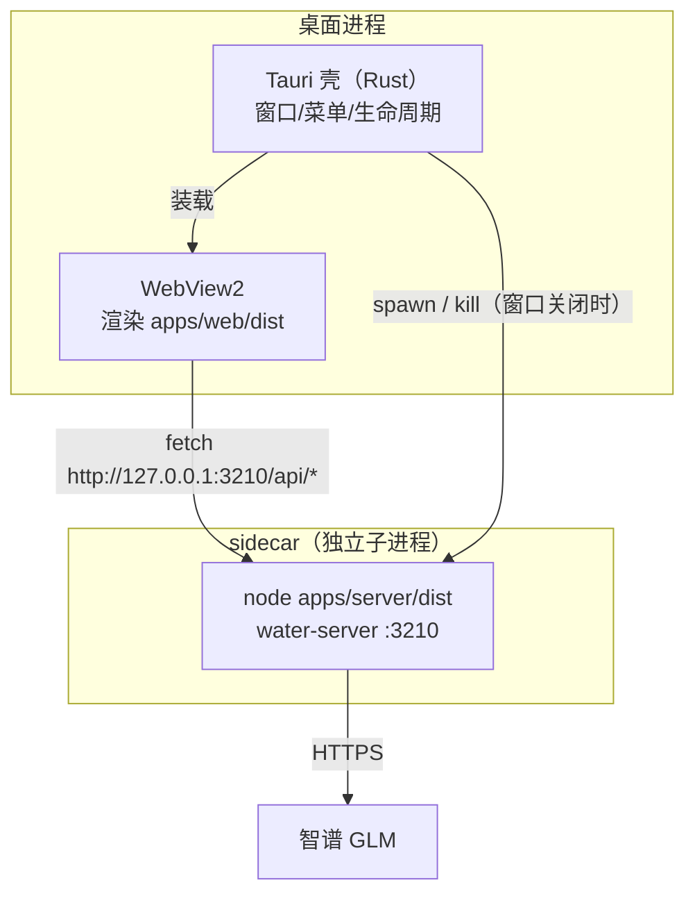

# 06 · Tauri vs Electron：桌面端取舍与 sidecar 架构

> 阶段：P4 ｜ 代码：`apps/desktop/`
> 本篇回答：**桌面端壳怎么选，以及「壳里的内核从哪来」这个真正的难题。**

## Tauri vs Electron 决策表

| 维度 | Tauri 2（本项目选择） | Electron |
|---|---|---|
| 渲染层 | 系统 WebView（Win=WebView2） | 自带 Chromium |
| 包体 | ~10MB | ~150MB+ |
| 后端语言 | Rust（壳） | Node.js（主进程） |
| 内存 | 低（共享系统组件） | 高（每窗口一个 Chromium） |
| 一致性风险 | WebView 版本碎片化 | 自带渲染，行为完全一致 |
| 原生能力 | Rust 全能 | Node 生态直接复用 |

选择 Tauri 的决定性理由：**前端零改动**（P3 的 React 应用直接装进 WebView），
而 Water 的内核本来就是独立 Node 进程（server），不依赖 Electron 的「主进程即 Node」模型。

## sidecar 架构：壳与内核的关系



三个关键点：

### 1. 为什么 server 不内嵌进 Rust

理论上可以把内核重写进 Rust（或 Rust 里嵌 Node），但那违背项目的最大资产：
**一份 TS 内核，三端复用**。sidecar（外挂子进程）让桌面端白捡 Server 的全部能力，
代价是多一个进程和一次本机 HTTP 回环——对本机应用完全可接受。

### 2. WebView 里的 API 基地址问题

Web 版浏览器里 `/api/*` 是同源相对路径；桌面端 origin 是 `tauri://localhost`，
相对路径会打到不存在的协议上。解法一行（`apps/web/src/api.ts`）：

```ts
const BASE = '__TAURI__' in window ? 'http://127.0.0.1:3210' : '';
```

检测 `window.__TAURI__`（tauri.conf.json 里 `withGlobalTauri: true` 注入）切换基地址。
CORS 已由 server 的 `cors()` 中间件放行。

### 3. sidecar 的生命周期

- **启动**：Rust `setup()` 里 spawn `node apps/server/dist/index.js`
- **降级**：检测不到 `ZHIPU_API_KEY` 时自动 `WATER_MOCK=1`——桌面端开箱即玩
- **清理**：窗口 `Destroyed` 事件里 kill 子进程，不留孤儿
- **生产硬化（TODO）**：现在依赖系统 node；正式发布应把 server 打成
  Node SEA（单文件可执行）作为 Tauri externalBin sidecar，随包分发

## 现状与验证

- `cargo 1.99.1` + MSVC Build Tools 18 + WebView2 156 环境就绪
- `tauri dev` 首次编译需拉取/编译数百 crate（一次性，有缓存）
- 验证标准：桌面窗口打开 → 侧栏/会话可用 → 发消息走通 SSE（mock 或 GLM）

## 延伸调研

完整版调研报告（选型空间全景、各组件原理、2026 实测数据、风险登记册、参考来源）：
[docs/research/P4-桌面端技术栈调研.md](../research/P4-桌面端技术栈调研.md)

## P4 验收清单

- [x] Tauri 2 骨架（tauri.conf.json / lib.rs sidecar 管理）
- [x] Web API 基地址桌面适配（`__TAURI__` 检测）
- [ ] 桌面窗口实测（编译完成后）
- [ ] Node SEA sidecar（生产硬化，后续迭代）
