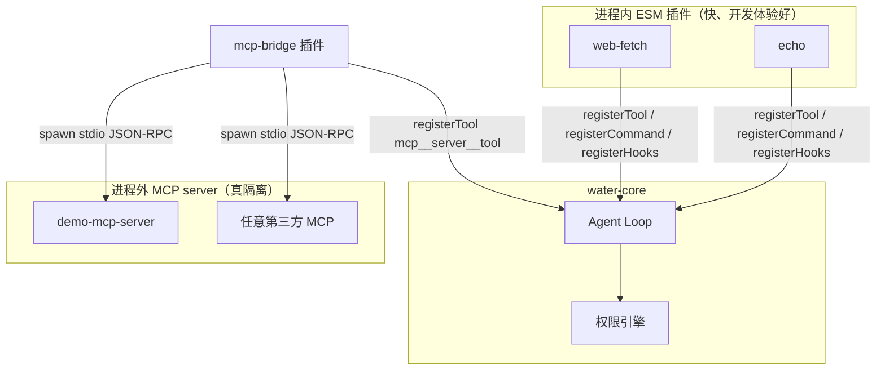

# 07 · 插件系统设计：隔离、权限与版本兼容

> 阶段：P5 ｜ 代码：`packages/core/src/plugin/`、`plugins/`
> 本篇回答：**怎么让第三方代码安全地长进内核里？**

## 总体形态：进程内插件 + MCP 逃生舱



为什么是这个组合：进程内插件性能零损耗、能拿到完整上下文，但 JS 没有可靠的运行时沙箱
（vm 模块逃逸史劣迹斑斑）；真要跑不完全信任的代码，**唯一的硬边界是进程边界**——
所以 MCP 桥接不是可选项，是安全模型的组成部分。

## 关键设计决策

### 1. 插件 = 一个目录 + 一个契约

```
plugins/echo/
├── water-plugin.json   # manifest：name/version/main/permissions
└── index.js            # 契约：export default { activate(ctx), deactivate?() }
```

`activate(ctx)` 能注册三种东西：**工具**（进 Loop 工具表）、**斜杠命令**（模板展开）、
**钩子**（beforeToolCall 可阻止执行 / afterToolCall 审计）。
没有事件总线、没有依赖注入容器——MVP 阶段，三个注册口足够覆盖 90% 的扩展场景。

### 2. 权限声明是治理契约，不是沙箱

manifest 里的 `permissions: ["network"]` 有两个**真实生效**的作用：

1. **加载时提升风险级**：声明 `network/fs:write` 的插件工具最低提到 medium（每次询问）；
   声明 `shell/process:spawn` 的强制 high。插件作者没法把危险工具伪装成低风险。
2. **安装前可见**：UI 的权限徽章（P0 原型定的锚点）从这里取数。

同时如实承认边界：进程内插件如果真恶意，声明挡不住它（`fetch` 是全局的）。
所以进程内插件的信任级别 = 「我读过或我写的代码」，其余一律走 MCP。

### 3. 失败隔离：插件崩 ≠ 宿主崩

加载器对每个插件 try/catch，失败只记入 `registry.plugins[].error` 并继续；
钩子调用全部包 try/catch（`beforeToolCall` 异常按「不阻止」处理——
钩子挂掉导致所有工具不可用，比漏掉一次审计更糟）。

### 4. MCP 桥接的实现要点（plugins/mcp-bridge）

- **传输**：stdio + 换行分隔 JSON-RPC 2.0（MCP 标准）
- **握手**：`initialize` → `notifications/initialized` → `tools/list`
- **工具映射**：`mcp__<server>__<tool>` 全名注册，risk 强制 high
- **Windows 坑**：`spawn(cmd, {shell:true})` 只对 `.cmd/.bat` 开壳
  （裸 exe 走壳会触发 DEP0190 且参数不转义有注入面——实测踩到并修复）
- **生命周期**：`deactivate()` 里 kill 所有子进程，不留孤儿

### 5. 版本兼容的前瞻

manifest 预留 `engines.water` 字段。插件 API 的兼容策略（写在这里，P5 起生效）：

- 只增不改：`PluginContext` 可以加新 register 方法，绝不改已有签名
- major 版本允许破坏性变更，加载器按 `engines.water`  semver 检查，不兼容拒绝加载并明示原因

## 实测记录

```
npx tsx scripts/plugin-test.ts
✓ 加载 3 个插件（echo / web-fetch / mcp-bridge）
✓ fetch_url 风险级被提升为 medium（network 权限生效）
✓ mcp__demo__mcp_echo 风险级 high（process:spawn 生效）
✓ echo 实跑 / MCP 桥实跑 mcp_echo: hello mcp / fetch_url 实跑本地 API
```

Server 启动时自动加载，`GET /api/plugins` 输出全量清单（含加载错误），
斜杠命令 `/review <path>` 在消息端点展开为提示词。

## P5 验收清单

- [x] 插件契约 + manifest + 加载器（发现/校验/激活/失败隔离）
- [x] 三种注册能力（工具/命令/钩子）全通
- [x] 权限声明 → 风险级提升真实生效
- [x] MCP 桥接最小实现（握手/工具列表/调用/超时/清理）
- [x] 闭环测试 PASS（含进程外调用）
- [ ] npm 分发插件（`npm i water-plugin-*` 后自动发现）——留待 P6 分发阶段
- [ ] Web 插件市场页接 `/api/plugins`——留作 Web 迭代

**下一步（P4 桌面端 / P6 Docker 交付）**：P4 等你装好 Rust 工具链；P6 不依赖 Rust，可以先做。

## v0.3 深化补遗：白名单安全模型的三次复用

插件系统当年引入的"manifest 声明 + 校验"思想，在后续演进中被复用了三次，
说明它抓住了某类问题的本质——**前端/第三方不可信输入 → 服务端白名单收敛**：

| 场景 | 不可信输入 | 白名单 | 拒绝行为 |
|---|---|---|---|
| M1 模型 | 浏览器传 model/baseUrl | 模型注册表 | 未知模型 400；baseUrl 字段显式 400（防 key 外泄） |
| M7B 工作区 | 浏览器传 workspaceId | workspaces.json + env 注册表 | 任意路径 400（防目录逃逸） |
| P5 插件 | 第三方插件声明权限 | VALID_PERMISSIONS | 未知权限拒载；shell 类声明强制风险提升 |

**MCP 桥接的现实局限**（诚实记录）：进程外 MCP server 的工具调用走 stdio 一对一，
无并发池化；配置在 `.water/mcp.json`，改动需重启——离 OpenCode 的 MCP 生态
（多 server、OAuth、资源订阅）还有明显距离，v0.3+ 再补。

**与 OpenCode 对照**：它的插件是"配置即插件"（JSON 声明工具/钩子）+ 进程内 TS 两条路；
Water 只做了 ESM 进程内 + MCP 逃生舱。配置式插件（零代码注册简单工具）是值得抄的作业。

## v0.6 深化补遗：白名单安全模型的第四次复用（M17 配置式工具 / M22 出网）

v0.3 补遗总结了白名单模型的三次复用（模型注册表 baseUrl、会话配置字段、配置式命令）。v0.5/v0.6 把它推进到第四处，且这次同时复用了**两条红线**：字段白名单（防夹带）+ 凭据只走环境变量。

### M17：prompt 型配置工具——命令的安全模型平移到工具层

`config.json` 的 `tools[]` 声明 JSON Schema 工具直接进注册表。执行语义定为 prompt 型（模型调用 → 模板 `$参数` 替换 → 渲染文本作为 tool_result 返回），与 M13 命令同源：零网络面、零凭据面。校验三件套沿用：字段白名单（仅 name/description/kind/template/http/parameters——**无任何执行体字段**，夹带 command 即拒）；description 必填（模型靠它决策，缺失=能力不可用）；与内置重名启动即拒。

prompt 型与命令的差别只在触发方：命令由用户敲、工具由模型按 Schema 自主调用。同一套安全模型自然延伸——这是「配置即插件」能分两步走（M17 prompt → M22 http）而不需要 redesign 的原因。

### M22：http 型——出网工具的三件套

```json
{ "name": "lookup", "kind": "http", "description": "…", "parameters": {…},
  "http": { "url": "https://api.example.com/v1?q=$q",
            "headers": { "Authorization": "Bearer $env:MY_KEY" } } }
```

三条安全性质，各对应一个机制：

1. **防 SSRF = 域名白名单**（顶层 `allowedHttpHosts`）：url host 不在白名单、或配置了 http 工具却没配白名单——启动即拒。白名单在 `loadFileConfig`（解析层）校验，`configHttpToolToTool`（包装层）不重复查——**分层信任**：每层只做自己该做的检查，避免「双查漂移」（两处检查后来只改了一处）；
2. **凭据红线 = `$env:` 唯一通道**：header/body 里引用环境变量名，运行时取值（DPAPI 注入链路天然兼容），值永不入 config、不 echo 进错误信息。与「config 出现凭据字段即拒」是同一红线的两面：明文不能存，明文也不能传；
3. **知情权 = 风险恒 high**：出网是可观测副作用，`riskFor` 恒 high 逐次审批——用户对每次出网有否决权。

一个实现细节值得记：插值必须是**单遍**的。`$env:VAR` 和 `$param` 用同一个正则一次性替换（`/\$env:([A-Za-z_]\w*)|\$(\w+)/g`）——若分两遍跑，环境变量的**值**若含 `$xxx` 会被第二轮当参数再解释，凭据值可能被意外重写。单遍替换的输出不再进入插值语境，这是注入类 bug 的通用防御。

边界三件套：method 白名单（GET/POST/PUT/DELETE/PATCH）、超时 10s（AbortController，参数化便于测试）、响应截断 64KB（工具结果只是上下文素材，不是数据管道）。

### 复用对照（v4 次之后）

| 复用处 | 白名单内容 | 拒绝时机 | 同构的红线 |
|---|---|---|---|
| 模型注册表（M1） | baseUrl 不可由前端指定 | 请求期 400 | 凭据不出服务端 |
| 会话配置（M1/M7B） | protocol/model/archived/workspaceId | 请求期 400 | 同上 |
| 配置式命令（M13） | name/template/description | 启动期抛错 | config 无凭据字段 |
| 配置式工具 prompt 型（M17） | + kind/parameters | 启动期抛错 | 无执行体字段 |
| 配置式工具 http 型（M22） | + http{url,method,headers,body}；**url host** | 启动期抛错 | 凭据只走 `$env:` |

M21 的授权继承（`inheritableGrants` 只导出带前缀 key）是同一哲学的变体：**用数据形状而非运行时分支承载安全性质**。这条线从 M1 一路画到 M22，是这个项目里最稳定的设计资产。
