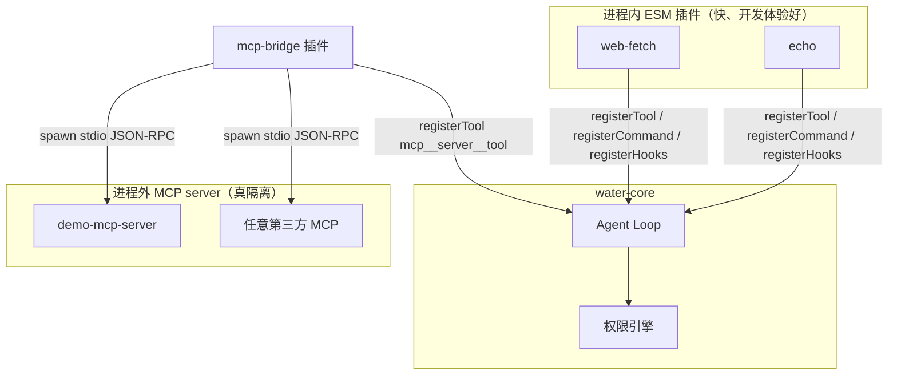

# 07 · 插件系统设计：隔离、权限与版本兼容

> 阶段：P5 ｜ 代码：`packages/core/src/plugin/`、`plugins/`
> 本篇回答：**怎么让第三方代码安全地长进内核里？**

## 总体形态：进程内插件 + MCP 逃生舱



为什么是这个组合：进程内插件性能零损耗、能拿到完整上下文，但 JS 没有可靠的运行时沙箱
（vm 模块逃逸史劣迹斑斑）；真要跑不完全信任的代码，**唯一的硬边界是进程边界**——
所以 MCP 桥接不是可选项，是安全模型的组成部分。

## 关键设计决策

### 1. 插件 = 一个目录 + 一个契约

```
plugins/echo/
├── water-plugin.json   # manifest：name/version/main/permissions
└── index.js            # 契约：export default { activate(ctx), deactivate?() }
```

`activate(ctx)` 能注册三种东西：**工具**（进 Loop 工具表）、**斜杠命令**（模板展开）、
**钩子**（beforeToolCall 可阻止执行 / afterToolCall 审计）。
没有事件总线、没有依赖注入容器——MVP 阶段，三个注册口足够覆盖 90% 的扩展场景。

### 2. 权限声明是治理契约，不是沙箱

manifest 里的 `permissions: ["network"]` 有两个**真实生效**的作用：

1. **加载时提升风险级**：声明 `network/fs:write` 的插件工具最低提到 medium（每次询问）；
   声明 `shell/process:spawn` 的强制 high。插件作者没法把危险工具伪装成低风险。
2. **安装前可见**：UI 的权限徽章（P0 原型定的锚点）从这里取数。

同时如实承认边界：进程内插件如果真恶意，声明挡不住它（`fetch` 是全局的）。
所以进程内插件的信任级别 = 「我读过或我写的代码」，其余一律走 MCP。

### 3. 失败隔离：插件崩 ≠ 宿主崩

加载器对每个插件 try/catch，失败只记入 `registry.plugins[].error` 并继续；
钩子调用全部包 try/catch（`beforeToolCall` 异常按「不阻止」处理——
钩子挂掉导致所有工具不可用，比漏掉一次审计更糟）。

### 4. MCP 桥接的实现要点（plugins/mcp-bridge）

- **传输**：stdio + 换行分隔 JSON-RPC 2.0（MCP 标准）
- **握手**：`initialize` → `notifications/initialized` → `tools/list`
- **工具映射**：`mcp__<server>__<tool>` 全名注册，risk 强制 high
- **Windows 坑**：`spawn(cmd, {shell:true})` 只对 `.cmd/.bat` 开壳
  （裸 exe 走壳会触发 DEP0190 且参数不转义有注入面——实测踩到并修复）
- **生命周期**：`deactivate()` 里 kill 所有子进程，不留孤儿

### 5. 版本兼容的前瞻

manifest 预留 `engines.water` 字段。插件 API 的兼容策略（写在这里，P5 起生效）：

- 只增不改：`PluginContext` 可以加新 register 方法，绝不改已有签名
- major 版本允许破坏性变更，加载器按 `engines.water`  semver 检查，不兼容拒绝加载并明示原因

## 实测记录

```
npx tsx scripts/plugin-test.ts
✓ 加载 3 个插件（echo / web-fetch / mcp-bridge）
✓ fetch_url 风险级被提升为 medium（network 权限生效）
✓ mcp__demo__mcp_echo 风险级 high（process:spawn 生效）
✓ echo 实跑 / MCP 桥实跑 mcp_echo: hello mcp / fetch_url 实跑本地 API
```

Server 启动时自动加载，`GET /api/plugins` 输出全量清单（含加载错误），
斜杠命令 `/review <path>` 在消息端点展开为提示词。

## P5 验收清单

- [x] 插件契约 + manifest + 加载器（发现/校验/激活/失败隔离）
- [x] 三种注册能力（工具/命令/钩子）全通
- [x] 权限声明 → 风险级提升真实生效
- [x] MCP 桥接最小实现（握手/工具列表/调用/超时/清理）
- [x] 闭环测试 PASS（含进程外调用）
- [ ] npm 分发插件（`npm i water-plugin-*` 后自动发现）——留待 P6 分发阶段
- [ ] Web 插件市场页接 `/api/plugins`——留作 Web 迭代

**下一步（P4 桌面端 / P6 Docker 交付）**：P4 等你装好 Rust 工具链；P6 不依赖 Rust，可以先做。
