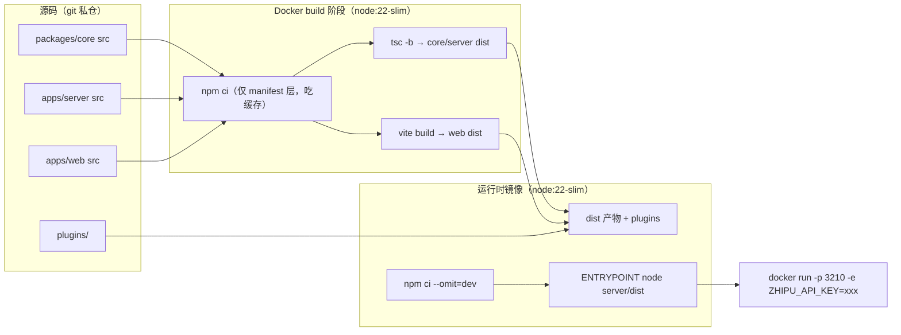

# 08 · 从源码到生产：构建、镜像与分发

> 阶段：P6 ｜ 产出：`Dockerfile`、`docker-compose.yml`、`.dockerignore`、`.env.example`
> 本篇回答：**一套 TS monorepo 源码，怎么变成一个 `docker run` 就能跑的东西？**

## 交付物全景



## 关键决策

### 1. 多阶段构建：构建环境与运行环境分离

构建阶段需要 typescript/vite/devDependencies（几百 MB），运行时只需要生产依赖 + dist。
分两阶段后镜像只含后者——**镜像体积和攻击面一起减**。

### 2. layer cache 的正确吃法

```dockerfile
COPY package.json package-lock.json ...   # 先只拷 manifest
RUN npm ci                                # 依赖层：源码变动不触发重装
COPY packages/core packages/core          # 再拷源码
RUN npx tsc -b ...                        # 构建层
```

manifest 不变 → `npm ci` 层命中缓存。顺序反了（先 COPY 全部）则每改一行代码都重装依赖。

### 3. 单进程交付：server 托管 Web 静态产物

不加 nginx。`@hono/node-server/serve-static` 托管 `apps/web/dist`，
API 路由注册在前优先匹配，其余路径 SPA fallback 回 `index.html`。
一个进程 = API + SSE + 前端，**这是学习项目最诚实的拓扑**——没有藏起来的组件。

### 4. 工作区是挂载点，不是镜像内容

Agent 操作的代码目录通过 `-v ./workspace:/workspace` 挂载，
镜像里只有 Water 本身。这样升级镜像不动工作区，工作区备份不涉及镜像。

### 5. 凭据红线在容器里的延续

- 镜像里**没有**任何 key（构建上下文里没有，`.dockerignore` 排掉 `.water/`）
- 运行时 `-e ZHIPU_API_KEY=xxx` 注入（compose 从宿主机 `.env` 读，`.env` 在 `.gitignore`）
- `HEALTHCHECK` 打 `/api/config`——存活探针不消耗 token、不碰凭据

### 6. npm 分发收尾（cli + core）

- 两个包都加了 `files: ["dist"]` 白名单 + `prepublishOnly: npm run build`（发包前强制构建，防发旧货）
- `npm pack` 实测产出 `water-core-0.1.0.tgz` / `water-harness-0.1.0.tgz`，内容经 `--dry-run` 审查过
- workspace 依赖（`@water/core: "*"`）要求两包同 registry 发布；私仓用 Verdaccio 或 GitHub Packages 皆可
- 安装形态：`npm i -g water-harness && water doctor`

## 已知待验证项（诚实清单）

- [ ] **`docker build` 未实测**：本机无 Docker Desktop。文件经静态审查，待有 Docker 的机器上验证
      （重点盯：`npm ci` 在 linux/amd64 解析 lockfile、esbuild 平台二进制、prisma 类原生模块——本项目无原生模块，风险低）
- [ ] compose 的 `./workspace` 首次启动需手动创建或允许 docker 自动建目录
- [ ] GLM 端点在容器内联网（公司代理场景需 `HTTPS_PROXY`）

## P6 验收清单

- [x] Dockerfile 多阶段（构建/运行时分离 + layer cache 优化 + HEALTHCHECK）
- [x] docker-compose.yml（端口/环境变量/工作区挂载/凭据注入）
- [x] `.env.example` + `.dockerignore` + `.gitignore` 三件套闭环
- [x] server 单进程托管 Web 产物，本地实测（首页 200 + API 正常）
- [x] npm pack 产物验证
- [x] [运维部署文档](../ops/deployment.md)
