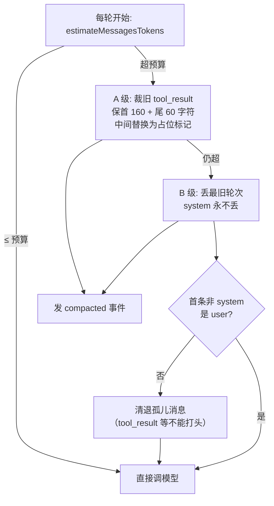

# 10 · 上下文管理与容错：让内核配得上「生产」二字

> 阶段：M2（v0.2.0）｜ 代码：`packages/core/src/context.ts`、`providers/retry.ts`、`loop.ts`
> 本篇回答两个问题：**历史无限增长时怎么办？网络抖一下就崩怎么办？**

## 一、上下文管理：00-导读里唯一「画了没做」的模块

0.1.0 架构图里画了「CTX 上下文管理 裁剪·摘要」，代码里却没有——长会话的结局
是确定的：历史超出模型窗口，provider 返回 4xx，会话死掉。

### 1.1 为什么是「估算」而不是「精确计数」

精确 token 计数需要 tokenizer——那意味着引入厂商 SDK 或 WASM 依赖，
违反内核零依赖红线。而上下文管理的目的只是**防超窗**，不是计费。
Water 的启发式：

```
tokens ≈ CJK字符数 × 1 + 其他字符数 ÷ 3.8
```

预算级误差（±20%）完全够用：窗口安全系数取 0.8，误差被系数吸收。

### 1.2 压缩策略：确定性优先，逐级降级



三个关键决策：

1. **先裁 tool_result**：一段 2000 字符的 grep 输出 ≈ 500 token，但对后续
   轮次的价值趋近于零——这是性价比最高的压缩对象。占位标记保留首尾，
   模型至少知道「这个工具跑过、结果大概是什么形状」。
2. **结构合法性是硬约束**：两家协议都要求首条非 system 消息必须是 user；
   Anthropic 的 tool_result 必须紧跟对应 tool_use。丢弃操作按「整段清退」
   进行，孤儿消息一律不留——**压缩后的历史必须仍然是一份合法对话**。
3. **确定性优先于 LLM 摘要**：摘要压缩（把旧对话总结成一段话）效果好，
   但要额外一次模型调用、失败模式复杂。先把确定性策略做对，摘要是
   后续可选增强（接口已预留：compactMessages 是纯函数，可替换策略）。

### 1.3 预算从哪来

M1 的模型注册表在这里直接变现：`ModelInfo.contextWindow × 0.8` 就是预算。
测试可用 `WATER_MAX_CONTEXT_TOKENS` 强制覆盖——离线复现超窗场景不需要
真的聊满 128k。

## 二、容错：一次 429 不该杀死一个长任务

真实网络里，429/500/502/503 是常态而非异常。0.1.0 的行为：fetch 失败 →
`finish:error` → 会话终止。M2 的重试网关三条纪律：

| 纪律 | 理由 |
|---|---|
| **只在流首帧前重试** | 一旦 token 已经流给用户，重试 = 重复输出。建立连接阶段的失败是幂等的，产出阶段的不是 |
| **中断不重试** | 用户按 Esc 是意图不是故障；AbortError 直接穿透 |
| **尊重 Retry-After** | 服务端明说的等待时间优先于指数退避（1s/2s/4s，上限 3 次） |

超时用 `AbortSignal.any([用户信号, AbortSignal.timeout(120s)])` 合并——
Node 22 原生支持，零依赖。

## 三、中断语义的隐性 bug

修 M2 时发现 0.1.0 的一个隐 bug：**中断后，半截 assistant 消息仍然入历史**。
流式输出到一半用户按了 Esc，已收集的 textBuf 照样 push 进 messages——
下一轮模型会看到一段话痨一半的「自己的发言」。M2 修复：中断时丢弃
半截消息（不完整的输出没有回传价值）。

## 四、验证证据

- `npm run test:context`（进 CI）：估算器量级 / 压缩三级策略 / 孤儿清退 /
  Loop 集成（compacted 事件 + 模型视角历史合法）/ 429×2 重试成功 /
  中断零重试
- E2E 扩至 21 断言：`/model` `/model <id>` `/compact` `/system` 全链路
- 真实 GLM 冒烟：默认预算（glm-4.6 200k × 0.8 = 160k）短会话不触发压缩

## 遗留与下一步

- LLM 摘要压缩（compaction v2）：策略接口已留，等真实超窗案例出现再做
- SSE 断线恢复（事件回放）：排在 M3（Web 体验）——重连补帧属于前端体验问题
- token 估算器的实测校准：攒一批真实会话后对照 API 返回的 usage 修正系数
