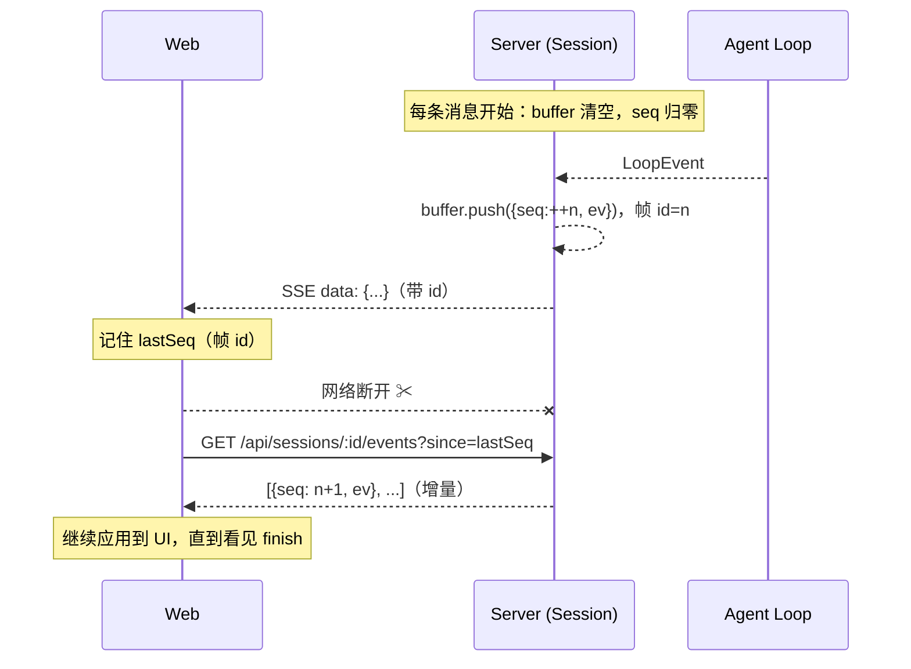

# 11 · SSE 事件回放与可信渲染：断线之后发生了什么

> 阶段：M3（v0.2.0）｜ 代码：`apps/server/src/session.ts`（回放缓冲）、`apps/web/src/markdown.ts`、`diff.ts`
> 本篇回答两个问题：**流断了怎么接上？模型输出的富文本怎么安全地渲染？**

## 一、SSE 的先天缺陷与回放设计

POST + SSE 的流式方案（文章 03）有一个先天缺陷：**连接即通道，断连即失联**。
浏览器刷新、网络抖动、代理超时——任何一种都会让正在进行的 Loop 事件流蒸发，
用户只看到一个永远转圈的会话。

### 1.1 回放缓冲：给流加一个"录像"



三个设计点：

1. **缓冲按「运行」重置**，而不是按会话累计——历史由 messages 端点负责
   （落库的最终态），缓冲只覆盖"当前这一跑"的中间事件。刷新页面后
   `since=0` 就是本次运行的完整回放，与水合的历史天然无重叠。
2. **seq 单调递增、帧 id 携带**——SSE 协议本身有 Last-Event-ID 重连机制，
   但 EventSource 不支持 POST；Water 用 `id:` 帧头 + `?since=` 查询参数
   达成同等语义，且对自定义 fetch 解析器更直白。
3. **容量 300 封顶**（环形丢弃）——回放是兜底通道不是持久化，超长任务的
   完整记录在 messages/tasks 里。

### 1.2 前端恢复状态机

```
流正常 → 消费事件（记录 lastSeq） → finish → 结束
流异常 → 是用户中断（AbortSignal）？ → 是：放弃（意图明确）
                                  → 否：轮询 events?since=lastSeq
                                    每 1.5s，直到 finish / 10min 上限
刷新页面 → 水合历史 → 会话 busy？ → 是：从 since=0 接流 → 否：静态展示
```

「用户中断」与「网络断开」的区分是关键：前者是意图，重连是 bug；
后者是故障，重连是修复。

## 二、可信渲染：模型输出不是 HTML，是数据

Web 端要渲染 markdown 后，XSS 面立即出现。模型输出**不可信**——提示注入
可以让它产出 ``。两条路线：

| 路线 | 做法 | 风险 |
|---|---|---|
| marked + DOMPurify | 解析成 HTML 字符串 → 消毒 → innerHTML | 消毒规则永远在追赶新的绕过姿势 |
| **解析成结构，渲染成元素** | 解析器输出 Inline/Block 树 → React 文本节点 | **没有 innerHTML，就没有注入面** |

Water 选后者：`markdown.ts` 是纯函数（可独立测试），`Md.tsx` 把块映射为
React 元素——模型写的任何 `<script>` 都只会成为一段字面文本。安全性是
**架构保证**，不依赖过滤规则的完备性。

链接单独处理协议白名单（http/https），`javascript:` 一类降级为纯文本——
这是唯一会生成 `<a>` 的地方，攻击面收敛到一个正则。

## 三、行级 diff：审批体验的最后一块

M0 评估时记录的缺口：edit 审批卡"全删全增"，看不出改了哪几行。M3 用
朴素 LCS（O(n·m) DP + 回溯）产出三态行（ctx/del/add）。没有用 Myers
diff 等优化算法——代码评审场景行数有限，**可讲清原理**比最优复杂度重要
（这也是本项目一贯的取舍）。

## 四、验证证据

- `test:web`（进 CI）：块级/行内解析、未闭合围栏容错、**XSS 契约**
  （HTML 标签全部落为 text 节点）、链接协议降级、diff 三态与统计
- E2E 扩至 27 断言：SSE 帧 id 从 1 递增、`events?since=0` 完整回放、
  `since=末尾` 增量为空
- 手动路径：mock server + 刷新 busy 会话可接流（验收清单项）

## 遗留与下一步

- EventSource/WebSocket 传输层与 Last-Event-ID 原生重连的对比（可做协议实验文章）
- markdown 表格/任务列表等语法按需追加（解析器是纯函数，扩展零风险）
- 回放缓冲的跨进程方案（多实例部署时挪进 Redis——单机 SQLite 场景暂不需要）
