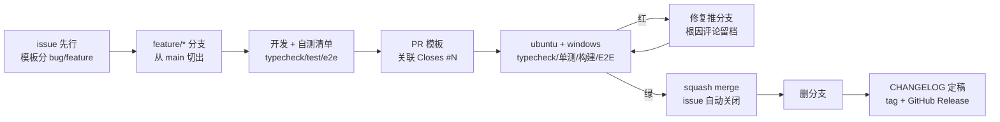

# 12 · 开源工程实践实录：一个私仓如何按公开标准运营

> 阶段：M5（v0.2.0）｜ 素材：M0-M4 的全部真实操作（PR #2/#6/#8/#10/#12，issue #1/#3/#4/#5/#7/#9/#11）
> 本篇回答一个问题：**「会写代码」和「会运营一个开源项目」之间差了什么？**
> 所有事件都真实发生过，链接可查、命令可复现。

## 一、总览：一个变更的完整生命周期



每个环节都有一个真实的踩坑故事，逐个讲。

## 二、地基清单：M0 的取舍（PR #2）

转公开之前就该补齐的九件套：`LICENSE`、`CONTRIBUTING.md`、issue 模板（bug/feature）、
PR 模板、CI、`CHANGELOG.md`、分支模型、tag/Release、milestone。几个当时做对的决策：

1. **LICENSE 是法律状态不是装饰**——README 写着 MIT 但文件不存在时，GitHub 不识别许可，
   法律上等于「保留所有权利」。一句话：声称 ≠ 拥有。
2. **CI 的默认形态是 mock**——三步验证（typecheck/单测/构建+E2E）全程零凭据。
   真实联调留在本地（DPAPI 注入），凭据红线因此天然满足，CI 也不会因为
   key 过期而变红。
3. **squash merge**——一个 PR = main 上一条提交，标题遵循 Conventional Commits，
   main 历史与 CHANGELOG 一一对应，`git log` 本身就是变更日志。

## 三、CI 立的第一功：tsbuildinfo 事件（变异实战课）

**时间线**（2026-10-29，PR #2 首跑）：

```
16:53  push 分支 → CI 自动触发
16:53  ubuntu 14s 失败 / windows 38s 失败（双平台一致 = 必是代码问题）
16:55  拉日志：Cannot find module '@water/core'（server/cli 全部源文件）
16:57  定位：三个 tsconfig.tsbuildinfo 曾被误提交。
       CI 全新 checkout → tsc -b 误判 core「已是最新」→ 跳过构建
       → dist/ 从未生成 → 下游解析失败
17:0x  本地无法复现！——因为本地残留历史构建产物
17:1x  修复：git rm --cached + .gitignore，按 fresh-checkout 等价状态本地验证
```

三条教训写进了 [PR 评论](https://github.com/wsj502/water-ai-harness/pull/2#issuecomment-6503004914)：

- **「我机器上没问题」正是 CI 存在的理由**——本地环境是脏的，CI 是唯一干净的房客
- 构建状态文件（tsbuildinfo/缓存/产物）永不入库，这条后来又用一次：
  M4 首次提交误入 `coverage/` 报告，同样手法修正（.gitignore + amend）
- 快速失败时间是最好的告警——14 秒红比 14 分钟绿更容易定位

## 四、分支保护与付费墙：一个 403 教会我的事

M0 想给 main 上分支保护（要求 PR + CI 绿 + 线性历史），API 返回：

```
403: Upgrade to GitHub Pro or make this repository public to enable this feature.
```

**私有仓库的分支保护是付费功能**——这是很多教程不会告诉你的事实。应对：

- 立即建 [issue #4](https://github.com/wsj502/water-ai-harness/issues/4) 挂账：
  转公开当日执行的启用清单（含备好的 JSON 载荷，一条 `gh api` 生效）
- 过渡期靠**流程纪律兜底**：CONTRIBUTING 写明「绝不直推 main」，
  实际执行中 M0-M4 全部 5 个 PR 零直推
- 顺带的知识：ruleset（新形态）同样吃这个付费墙

## 五、版本发布流：tag 指向的语义

```
git tag -a v0.1.0 8362f6f          # ← 指向 P0-P6 终态，不是 main HEAD
git push origin v0.1.0
gh release create v0.1.0 --notes-file release.md --verify-tag --latest
```

为什么 tag 不打在 M0 合并后的 HEAD 上？因为 **0.1.0 的语义是「P0-P6 的功能骨架」**，
M0（LICENSE/CI）属于 Unreleased。Release notes 里还写了「已知限制」段落——
诚实的限制清单（模型写死/无上下文管理/零测试）后来全部在 v0.2.0 周期内兑现修复，
这本身就是路线图的最好来源。

## 六、issue 驱动的一切

实践中的 issue 分类学：

| 类型 | 例子 | 用法 |
|---|---|---|
| 功能 issue（验收清单） | [#3](https://github.com/wsj502/water-ai-harness/issues/3) 模型切换 | PR 描述写 `Closes #3`，合并自动关 |
| 运维挂账 issue | #4 分支保护 | 带可执行清单，时机成熟一键完成 |
| 备忘 issue | [#5](https://github.com/wsj502/water-ai-harness/issues/5) 用户侧事项 | 表格记录「谁/何时/怎么做」，跨会话不丢 |
| milestone | v0.2.0 | PR/issue 全部挂靠，进度即看板 |

备忘 issue 是单人项目对抗「转头就忘」的最优解——它让协作约定（比如
「转公开时提醒用户」「暂无 npm 账号」）变成仓库资产而不是聊天记录。

## 七、测试的元测试：变异验证（M4）

怎么证明 golden 测试真的能抓住回归？人为破坏一次：

```powershell
# 把 openai.ts 的 stop 映射从 'end' 改成 'tool_use'
npx vitest run tests/providers.golden.test.ts   # → 红
git checkout -- packages/core/src/providers/openai.ts
npx vitest run tests/providers.golden.test.ts   # → 绿
```

没有这一步，测试数量只是心理安慰；有了这一步，「92% 协议层覆盖率」
才是可辩护的数字。

## 八、翻车实录（比成功更有信息量）

1. **PAT 缺 workflow scope**：推 `.github/workflows/` 被拒
   `refusing to allow a PAT to create or update workflow without workflow scope`——
   最终用 gh 设备流认证一次到位（`gh auth login -w`，scope 自动申请正确）
2. **PowerShell 5.1 的 `--` 解析**：`start-secure.ps1 -- node ...` 报
   「找不到接受实际参数的位置形式参数」——绕过：直接调底层 `tools/envload.py`
3. **中文控制台乱码**：测试输出经 PowerShell 管道后 UTF-8 变天书——
   排障时用 `cmd /c "... > log 2>&1"` 重定向再读文件
4. **coverage/ 误入库**（见第三节）——amend + `--force-with-lease` 修正 feature 分支

## 九、可复现命令速查

```powershell
gh auth login -h github.com -p https -w        # 设备流认证（scope 全齐）
gh issue create --title ... --body-file ... --label feature --milestone v0.2.0
git checkout -b feature/m1-provider-registry   # 分支名 = 里程碑 + 主题
gh pr create --base main --head ... --title 'feat(M1): ...' --body-file ...
gh pr checks 12 --watch --fail-fast            # 盯 CI
gh pr merge 12 --squash --delete-branch        # 合并 + 删分支
gh api -X PUT repos/OWNER/REPO/branches/main/protection --input prot.json
gh release create v0.2.0 --notes-file ... --verify-tag --latest
```

## 十、还没做但转公开前要做的

- [ ] main 分支保护（#4，载荷已备）
- [ ] README 重写（quickstart ≤ 3 条命令 / 截图 / 功能矩阵）——M6
- [ ] 外部贡献者 PR 的完整处理流（第二账号实测）——备忘 #5
- [ ] Discussions / good-first-issue 标签运营——公开后视情况

## v0.6 深化补遗：v0.5→v0.6 的发版节奏与翻车清单

正文记录了 M0-M4 的地基工程。v0.5（M15-M18）与 v0.6（M19-M23）两个版本之后，工程流程本身又沉淀了几条经验。

### 一、设计决策记在 issue 里，不记在对话里

M17 立项时 HTTP 型被暂缓，定案评论写在 issue #39 上（为什么选 prompt 型、HTTP 型的红线是什么、何时重启）。v0.6 立项 M22 时直接引用该评论开工——**issue 是决策的可寻址存档**，会话不是。同理，v0.6 的五个 issue 全部对应 v0.5.0 Release notes 里白纸黑字的「已知限制」或 #39 的承诺：立项不是想新点子，是兑现已记录的债务。

### 二、小坑：issue 并行创建会交叉编号

v0.5 立项时五个 issue 并行创建，GitHub 分配编号与创建请求的到达序一致而非发出序——结果 M17 拿了 #39、M18 拿了 #38，与里程碑序号错位。此后改为顺序创建（v0.6 的 #46-#50 与 M19-M23 严格对齐）。纯观感问题，但 roadmap 引用会别扭很久。

### 三、翻车清单（v0.5-v0.6，比成功有信息量）

1. **PS5.1 的 `2>&1` 会吞掉 gh 的输出流并中断其本地清理**：`gh pr merge --squash --delete-branch` 远端已生效，但管道里的 `2>&1` 让本地切回 main / 删分支的步骤没执行，留下一个多余的 merge 提交需要手工清理。两次翻车后固化做法：gh 命令一律 `| Out-Null`，清理自己做；
2. **wall-clock flaky**：「直播回放同构」断言直接 toEqual 两个折叠结果，唯一差异是 1ms 的 `ts` 时间戳——本地 Windows 两次折叠恰好同毫秒，CI ubuntu 揭示。修复：断言剥离 ts（比结构不比钟表）。教训：**凡比较「确定性输出」，先剔除一切非确定字段**；
3. **E2E 到达序竞态**：「两条并发消息按到达顺序入史」的断言隐含「先发出的 fetch 先到达」——跨连接不成立（可能走不同 socket），十几轮全绿后在高负载本机首次翻车。修复：第一条发出后轮询确认 busy 再发第二条，把「到达顺序」变成构造出来的确定性；
4. **并行化的次生 bug**：M16 让多会话并行后，任务 id `t_<毫秒时间戳>` 在两会话同毫秒完成时撞 SQLite 主键（E2E 日志里的 `UNIQUE constraint failed` 是现行证据）。修复：id 加随机后缀。教训：**并发化的回归面不在你改的代码，而在所有「以前靠串行才成立」的隐含假设里**；
5. **迁移丢语义**：M18 重写折叠器时丢了 M15「拒绝同时收拢审批卡」的逻辑（子级审批被拒时 sub loop 只 yield tool_denied，没有 tool_approved）——新测试第一轮就抓住了。为迁移写的新用例应该先枚举旧语义再动手，而不是重写完再补。

### 四、release PR 模式的复用体验

v0.5.0 与 v0.6.0 两次发版完全复用同一流程：功能 PR 不碰版本号 → release PR 一次 bump（root + 5 子包 + `/api/config`）+ CHANGELOG 定稿 + README 矩阵/路线图同步 → CI 绿 → squash → tag → `gh release create --notes-file`（notes 从 CHANGELOG 提炼，**必含已知限制清单**）→ 关 milestone。发版从一个需要谨慎对待的仪式，变成了一个下午的常规操作——流程被复用五次之后，它自己就成了文档。

### 五、给「一个人 + AI 协作开发」的流程注脚

这两个版本的实质是：人类负责方向判断（立项范围、M17 语义定案、发版批准），AI 负责全链路执行（分支/实现/测试/PR/CI/merge/发版），交界处全靠**纪律文本**（issue 验收标准、PR 模板检查项、CHANGELOG「为什么」）而非口头上下文。纪律文本写得越像规格说明，交接质量越稳定——这大概是这个项目对「如何与 AI 结对」最有 transferable 的结论。

## v0.7 深化补遗：回归债怎么还，权限 key 怎么稳

### 一、桌面端回归：把「宣称」变「事实」的成本核算

README 功能矩阵从 v0.1 起就写着「三端 ✅」，但 desktop 自 P5 后零回归——sidecar 二进制停留在 v0.1，而协议已演进四代（排队/并行闸门/审批回放/宽限期）。v0.7 收口这笔债（#58）的实际成本：

- **壳代码改动 29 行**：mock 判定与 server 侧凭据链路对齐（原来只认 `ZHIPU_API_KEY` 单名，且会覆盖用户显式设置的 `WATER_MOCK=0`）
- **重建产物零代码**：`build-sea.ps1` 全自动，瓶颈是官方 node.exe 基座下载（~93MB）
- **冒烟脚本 11 断言**：探活/版本/mock/会话/SSE 剧本/帧 id 单调/回放/持久化——不追求覆盖 UI，只回答「sidecar 在 v0.6 协议上还活着吗」

方法论：**回归债的利息远大于本金**。壳侧唯一真正的逻辑（进程治理 + 环境判定）改动极小，但四代协议的每一步都让「没验证」的风险复利增长。回归做得越晚，排查面越大——这与「并发化的回归面在所有以前靠串行才成立的假设里」是同一条规律的时间维版本。

### 二、「测试期望错了修期望」的现场课

SEA 冒烟首跑 9/10：SSE 剧本明明以 mock 形态走完，`mock = true` 断言却失败。排查发现 `/api/config` 用 `protocol: "mock"` 表达 mock 模式，`mock` 布尔字段在 `/api/models` 响应里——**断言写错了端点字段，产品行为是对的**。按纪律修期望而非改产品（先例：M20 渲染细节测试）。

判别式：当「产品明显在正确工作」与「测试说它错了」冲突时，先怀疑期望——尤其是对**另一个系统的契约**（这里是端点字段名）的断言，测试作者的记忆比代码更容易漂移。

### 三、授权 key 归一化：权限系统的「同一资源唯一键」

M21 让子级 write 的 session 授权按文件粒度继承，但 `argSummary` 用原始路径——`./a.txt` 与 `a.txt` 解析到同一文件，却是两个 grant key。模型两次写同一文件换了写法，就绕过继承重复打扰用户（#59）。

这本质是**记忆系统的 key 规范化稳定性**问题，与缓存键、幂等键同构：凡「凭输入记住决策」的系统，key 必须对等价输入唯一。修复收在 `argSummary` 源头（key 生成点分散在主循环与上浮两处，源头归一让 key 与审批卡显示天然一致），且**保守不做过缝**：`./sub/../a.txt` 这类相对段不做全量规范化——权限 key 宁可少合并（多问一次），不可误合并（少问一次就是安全缺口）。

### 四、翻车清单（v0.7）

1. **vitest 管道环境没有 `isTTY` 属性**：想用 `vi.spyOn(process.stdout, 'isTTY', 'get')` mock TTY，直接抛「property not defined」——管道环境下属性本身不存在，getter spy 无处挂载。修复：`Object.defineProperty` + descriptor 还原。教训：**spy 假定属性存在，defineProperty 不假定**——对环境探测类属性，后者才是稳妥原语；
2. **Actions API 的缓存延迟差点误判**：`gh pr checks` 与 jobs API 在 job 实际完成后数分钟仍报 pending/in_progress，step 级查询却已全部 success。教训：**判断 CI 状态卡住时，下钻一层（job→steps）比等待或重跑更便宜**；
3. **编辑测试文件手滑多打一个反引号**：模板串闭合错，本地跑挂了才看见——「本地先跑再提交」在零成本环节依然有价值。

### 五、issue 顺序创建的再验证

v0.7 的 #57/#58/#59 与 #62 全部顺序创建，编号与里程碑严格对齐（M24=#58、M25=#59、M26=#62）——v0.5 的教训（#38/#39 交叉）已固化为流程，四轮发版未再犯。

## v0.7→v0.10 四轮复盘：一天四版之后

同一天内 v0.7.0（桌面回归）/ v0.8.0（容器+BYOK）/ v0.9.0（并行执行）/ v0.10.0（live 长连接）
四轮完整发版——每轮都是立项→issue→实现→测试→PR→CI→merge→tag→release→milestone→容器重建
的全链路。这四轮的信息密度值得单独复盘。

### 一、节奏学：边际成本递减

v0.2 时代一个版本要数天；现在一轮 40–60 分钟。变化不在打字速度，在三处结构性的东西：

1. **流程脚本化**：bump 是 20 行 node 脚本（9 处版本号一次过）、release notes 有模板、CHANGELOG
   结构固化——机械步骤零决策成本；
2. **等待窗口并行**：CI 跑的 5–8 分钟正好用来写下一个 issue 的正文或下一版的文章草稿；
3. **验证工具链成型**：mock 剧本 + E2E 断言 + 浏览器 DOM 断言三层，改动后「证明它工作」
   从玄学变成例行公事。

流程被复用十次之后，它自己就成了文档——这句在 v0.6 补遗里写过，四轮同日是它的实证。

### 二、转向：从学习驱动到使用驱动

前六个版本（v0.2–v0.7）按学习路线图推进：每个里程碑对应框架的一个机制。v0.8 起的
issue 全部来自**真实部署与使用反馈**——Docker 容器化实测暴露构建上下文爆炸、真实模型
接入催生 BYOK、连续两批共七项 UI 反馈、使用中发现的流污染。这是开源项目的经典分水岭：
**dogfooding**。学习目标没有丢（BYOK 的安全模型、live 的观察者/写者分离都是内核级设计题），
但优先级的裁决权从路线图转移到了使用现场。

### 三、考古方法论

v0.8 的 UI 修复挖出两个 P0 时代隐性 bug：`:root` 布局变量块从第一天起就丢了选择器头
（孤儿声明被浏览器静默丢弃，`--sidebar-w` 等十个版本从未生效）；构建日志里的两条 esbuild
css warning 抱怨了几个版本，一直被当噪音——**它在报真问题**。

方法论沉淀：**构建警告要么修掉，要么显式忽略并记录原因，不存在「习惯了」**。警告是
工具链里唯一免费的持续审计，浪费它等于自愿降级调试能力。这次之后本项目的构建目标是
「零警告」（v0.8 起达成）。

### 四、纪律的弹性：CI 配额事件全记录

月末 Actions 配额紧张，PR #72 的 CI 排队 35+ 分钟不动。处置过程暴露了三层事实：

1. **平台行为**：required checks 处于 queued 状态时，`--admin` 合并也被拒绝（enforce_admins
   之上的平台级保护）——豁免通道比想象中窄；
2. **豁免的正确姿势**：用户授权 → PR 评论完整留痕（原因/替代验证证据/补偿措施）→
   临时 PUT 摘除 required_status_checks → merge → 立即恢复 → 事后 CI 自然补绿。
   豁免不是绕过纪律，是把纪律的例外也做成可审计的流程；
3. **教训**：当天晚些时候两个「卡死」的 run 其实都跑完了（排队慢 ≠ 配额尽）——
   **判断基础设施故障前，先下钻一层（job→steps）再下结论**。

### 五、时序竞态的判别式

v0.10 的 live 端点连续踩了两个时序坑，恰好构成一对判别式：

- **19b 测试失败**：live 与 POST 同时发起，live 建立时 server 尚未置 busy → 走了「补完即关」
  路径。真实场景无此竞态（接流都发生在 busy 确立后）——**测试期望的时序错了，修测试**；
- **9 帧缺 finish**：收到 finish 同步关连接，而 SSE 帧写入是异步的——尾帧没写完连接就关了。
  **产品真 bug，修产品**（finish 帧写入完成的 Promise 才收尾）。

判别式：**「产品明显在正确工作」与「测试报错」冲突时，先怀疑期望——但时序类失败永远
值得深挖**：第一个坑按直觉修测试就对了，第二个坑如果也当「测试问题」放过，就漏掉了
一个只在慢机器/慢网络上必现的真 bug。E2E 的价值恰恰在它跑在真实进程的真实时序里。

### 六、并发化两次实践的呼应

M16（跨会话并行）的教训是「回归面不在你改的代码，而在所有靠串行才成立的假设里」——
当时撞了 SQLite 主键。M27（同轮工具并发）拆最后一根串行假设时，**96 个旧用例零改动
全绿**：不是运气，是测试断言从没写过「工具结果按声明序到达」这种假设。两轮对照给出
写测试的元原则：**断言行为语义（谁完成了、结果对不对），不断言巧合时序（谁先到）**——
前者在并发化后依然成立，后者会在每一次并行化时爆炸。
