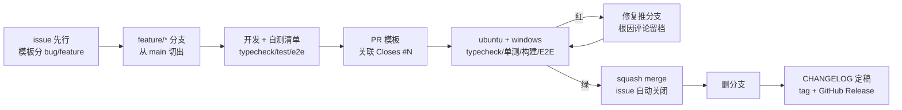

# 12 · 开源工程实践实录：一个私仓如何按公开标准运营

> 阶段：M5（v0.2.0）｜ 素材：M0-M4 的全部真实操作（PR #2/#6/#8/#10/#12，issue #1/#3/#4/#5/#7/#9/#11）
> 本篇回答一个问题：**「会写代码」和「会运营一个开源项目」之间差了什么？**
> 所有事件都真实发生过，链接可查、命令可复现。

## 一、总览：一个变更的完整生命周期



每个环节都有一个真实的踩坑故事，逐个讲。

## 二、地基清单：M0 的取舍（PR #2）

转公开之前就该补齐的九件套：`LICENSE`、`CONTRIBUTING.md`、issue 模板（bug/feature）、
PR 模板、CI、`CHANGELOG.md`、分支模型、tag/Release、milestone。几个当时做对的决策：

1. **LICENSE 是法律状态不是装饰**——README 写着 MIT 但文件不存在时，GitHub 不识别许可，
   法律上等于「保留所有权利」。一句话：声称 ≠ 拥有。
2. **CI 的默认形态是 mock**——三步验证（typecheck/单测/构建+E2E）全程零凭据。
   真实联调留在本地（DPAPI 注入），凭据红线因此天然满足，CI 也不会因为
   key 过期而变红。
3. **squash merge**——一个 PR = main 上一条提交，标题遵循 Conventional Commits，
   main 历史与 CHANGELOG 一一对应，`git log` 本身就是变更日志。

## 三、CI 立的第一功：tsbuildinfo 事件（变异实战课）

**时间线**（2026-10-29，PR #2 首跑）：

```
16:53  push 分支 → CI 自动触发
16:53  ubuntu 14s 失败 / windows 38s 失败（双平台一致 = 必是代码问题）
16:55  拉日志：Cannot find module '@water/core'（server/cli 全部源文件）
16:57  定位：三个 tsconfig.tsbuildinfo 曾被误提交。
       CI 全新 checkout → tsc -b 误判 core「已是最新」→ 跳过构建
       → dist/ 从未生成 → 下游解析失败
17:0x  本地无法复现！——因为本地残留历史构建产物
17:1x  修复：git rm --cached + .gitignore，按 fresh-checkout 等价状态本地验证
```

三条教训写进了 [PR 评论](https://github.com/wsj502/water-ai-harness/pull/2#issuecomment-6503004914)：

- **「我机器上没问题」正是 CI 存在的理由**——本地环境是脏的，CI 是唯一干净的房客
- 构建状态文件（tsbuildinfo/缓存/产物）永不入库，这条后来又用一次：
  M4 首次提交误入 `coverage/` 报告，同样手法修正（.gitignore + amend）
- 快速失败时间是最好的告警——14 秒红比 14 分钟绿更容易定位

## 四、分支保护与付费墙：一个 403 教会我的事

M0 想给 main 上分支保护（要求 PR + CI 绿 + 线性历史），API 返回：

```
403: Upgrade to GitHub Pro or make this repository public to enable this feature.
```

**私有仓库的分支保护是付费功能**——这是很多教程不会告诉你的事实。应对：

- 立即建 [issue #4](https://github.com/wsj502/water-ai-harness/issues/4) 挂账：
  转公开当日执行的启用清单（含备好的 JSON 载荷，一条 `gh api` 生效）
- 过渡期靠**流程纪律兜底**：CONTRIBUTING 写明「绝不直推 main」，
  实际执行中 M0-M4 全部 5 个 PR 零直推
- 顺带的知识：ruleset（新形态）同样吃这个付费墙

## 五、版本发布流：tag 指向的语义

```
git tag -a v0.1.0 8362f6f          # ← 指向 P0-P6 终态，不是 main HEAD
git push origin v0.1.0
gh release create v0.1.0 --notes-file release.md --verify-tag --latest
```

为什么 tag 不打在 M0 合并后的 HEAD 上？因为 **0.1.0 的语义是「P0-P6 的功能骨架」**，
M0（LICENSE/CI）属于 Unreleased。Release notes 里还写了「已知限制」段落——
诚实的限制清单（模型写死/无上下文管理/零测试）后来全部在 v0.2.0 周期内兑现修复，
这本身就是路线图的最好来源。

## 六、issue 驱动的一切

实践中的 issue 分类学：

| 类型 | 例子 | 用法 |
|---|---|---|
| 功能 issue（验收清单） | [#3](https://github.com/wsj502/water-ai-harness/issues/3) 模型切换 | PR 描述写 `Closes #3`，合并自动关 |
| 运维挂账 issue | #4 分支保护 | 带可执行清单，时机成熟一键完成 |
| 备忘 issue | [#5](https://github.com/wsj502/water-ai-harness/issues/5) 用户侧事项 | 表格记录「谁/何时/怎么做」，跨会话不丢 |
| milestone | v0.2.0 | PR/issue 全部挂靠，进度即看板 |

备忘 issue 是单人项目对抗「转头就忘」的最优解——它让协作约定（比如
「转公开时提醒用户」「暂无 npm 账号」）变成仓库资产而不是聊天记录。

## 七、测试的元测试：变异验证（M4）

怎么证明 golden 测试真的能抓住回归？人为破坏一次：

```powershell
# 把 openai.ts 的 stop 映射从 'end' 改成 'tool_use'
npx vitest run tests/providers.golden.test.ts   # → 红
git checkout -- packages/core/src/providers/openai.ts
npx vitest run tests/providers.golden.test.ts   # → 绿
```

没有这一步，测试数量只是心理安慰；有了这一步，「92% 协议层覆盖率」
才是可辩护的数字。

## 八、翻车实录（比成功更有信息量）

1. **PAT 缺 workflow scope**：推 `.github/workflows/` 被拒
   `refusing to allow a PAT to create or update workflow without workflow scope`——
   最终用 gh 设备流认证一次到位（`gh auth login -w`，scope 自动申请正确）
2. **PowerShell 5.1 的 `--` 解析**：`start-secure.ps1 -- node ...` 报
   「找不到接受实际参数的位置形式参数」——绕过：直接调底层 `tools/envload.py`
3. **中文控制台乱码**：测试输出经 PowerShell 管道后 UTF-8 变天书——
   排障时用 `cmd /c "... > log 2>&1"` 重定向再读文件
4. **coverage/ 误入库**（见第三节）——amend + `--force-with-lease` 修正 feature 分支

## 九、可复现命令速查

```powershell
gh auth login -h github.com -p https -w        # 设备流认证（scope 全齐）
gh issue create --title ... --body-file ... --label feature --milestone v0.2.0
git checkout -b feature/m1-provider-registry   # 分支名 = 里程碑 + 主题
gh pr create --base main --head ... --title 'feat(M1): ...' --body-file ...
gh pr checks 12 --watch --fail-fast            # 盯 CI
gh pr merge 12 --squash --delete-branch        # 合并 + 删分支
gh api -X PUT repos/OWNER/REPO/branches/main/protection --input prot.json
gh release create v0.2.0 --notes-file ... --verify-tag --latest
```

## 十、还没做但转公开前要做的

- [ ] main 分支保护（#4，载荷已备）
- [ ] README 重写（quickstart ≤ 3 条命令 / 截图 / 功能矩阵）——M6
- [ ] 外部贡献者 PR 的完整处理流（第二账号实测）——备忘 #5
- [ ] Discussions / good-first-issue 标签运营——公开后视情况
