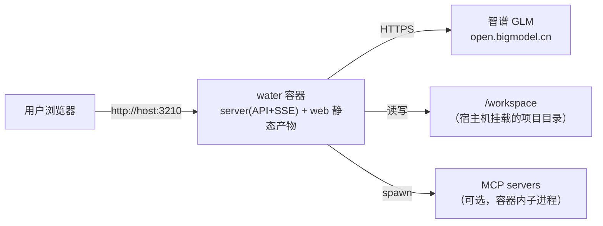

# Water 运维部署手册

> 面向部署者的操作文档。开发细节见 `docs/articles/` 系列。

## 1. 部署拓扑



单容器，无外部依赖（无数据库——会话在内存，重启即清空；持久化是后续迭代项）。

## 2. 部署步骤

```bash
# 1. 拉源码
git clone <私仓地址> water && cd water

# 2. 配凭据（.env 不会入库）
cp .env.example .env
$EDITOR .env   # 填入 ZHIPU_API_KEY，按需改 WATER_WORKSPACE

# 3. 建工作区目录并启动
mkdir -p workspace
docker compose up -d --build

# 4. 验证
curl http://127.0.0.1:3210/api/config   # 返回 protocol/model/version 即正常
```

## 3. 配置项全表

| 变量 | 默认 | 说明 |
|---|---|---|
| `ZHIPU_API_KEY` | （必填） | 智谱 key；换 DeepSeek 则用 `DEEPSEEK_API_KEY` + 改下面三项 |
| `WATER_PROTOCOL` | `anthropic` | `anthropic`（智谱/Claude）或 `openai`（DeepSeek/通义/vLLM） |
| `WATER_BASE_URL` | 智谱端点 | API base URL |
| `WATER_MODEL` | `glm-4.6` | 模型名 |
| `WATER_PORT` | `3210` | 服务端口 |
| `WATER_MOCK` | - | `=1` 离线 mock（无 key 演示用） |
| `WATER_PLUGIN_DIRS` | 镜像内 `/app/plugins` | 额外插件目录（冒号分隔） |
| `WATER_WORKSPACE` | `./workspace` | compose 专用：宿主机挂载源 |

## 4. 日常运维

| 操作 | 命令 |
|---|---|
| 看日志 | `docker compose logs -f water` |
| 重启 | `docker compose restart` |
| 升级 | `git pull && docker compose up -d --build` |
| 回滚 | `git checkout <旧tag> && docker compose up -d --build` |
| 健康检查 | 容器自带 HEALTHCHECK；`docker ps` 看 healthy 状态 |
| 进容器排障 | `docker compose exec water sh` |

## 5. 安全基线

- 凭据：只在 `.env`（宿主机）和容器环境变量里；**镜像层、git 历史、日志里都不应出现**
  （巡检：`docker history` 无 key 层；`git log -p | grep -i api_key` 应为空）
- 端口：3210 只绑内网/本机；公网暴露必须前置反代 + 认证（当前版本无鉴权！）
- 工作区：Agent 对 `/workspace` 有读写权，挂载目录按需收敛
- 插件：第三方插件默认走 high 风险审批；不完全信任的代码一律 MCP 进程外

## 6. 故障排查速查

| 症状 | 排查 |
|---|---|
| 401/鉴权失败 | key 过期→更新 `.env` → `compose up -d` 重建；**不要**把 key 发给任何人/AI |
| 首页白屏 | `docker compose logs water` 看 web dist 是否打进镜像（`WATER_WEB_DIST` 路径） |
| SSE 中断/审批无响应 | 反向代理缓冲 SSE：nginx 需 `proxy_buffering off;` 且放行长连接 |
| 工具全部待审批 | 低风险自动放行是否被关；检查会话权限规则 |
| 容器起不来 | `docker compose config` 校验 yaml；`docker compose up`（不带 -d）看前台报错 |
