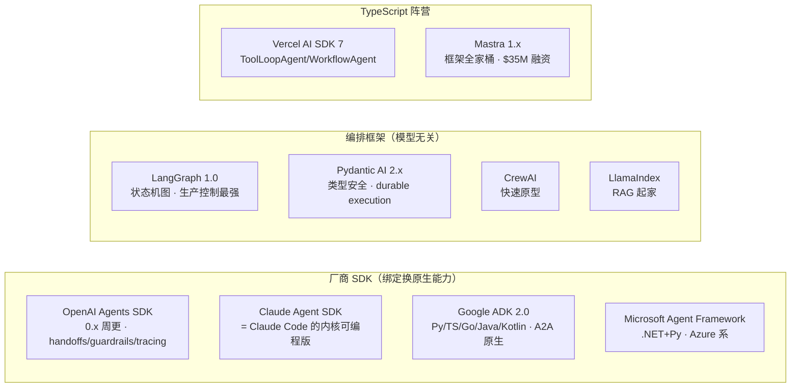
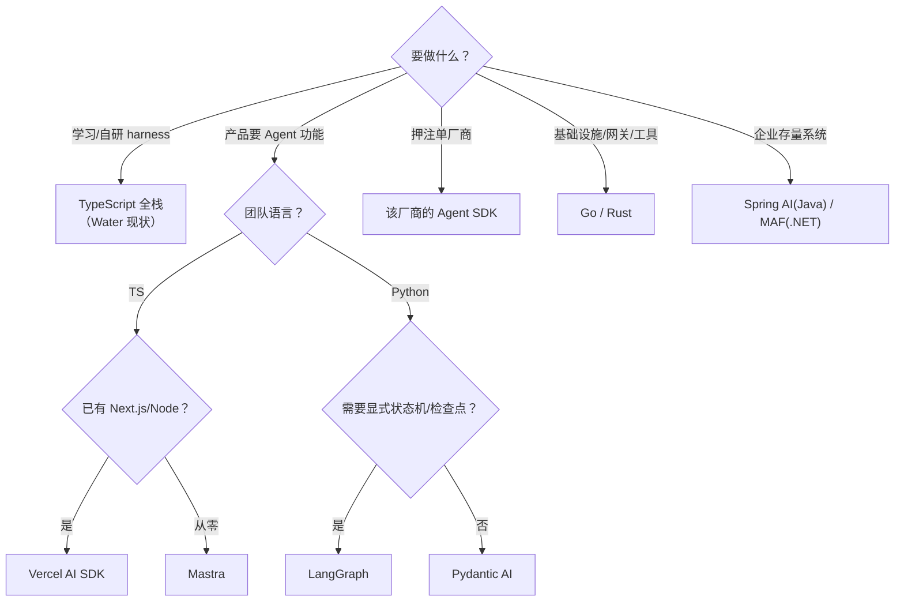

# AI 智能体框架与应用开发技术栈调研报告

> 目的：为「造一个 Agent Harness」回答三个问题——**用什么语言、借用什么框架、自己造哪层轮子**。
> 调研时间：2026-10-29 ｜ 结论先行，论证在后，参考来源见文末。

## 〇、TL;DR（结论速览）

1. **语言**：Agent 开发只剩两个第一梯队——**Python**（框架生态最全）和 **TypeScript**（前端/全栈一体化）。
   Go/Rust 是基础设施层语言（工具、网关、MCP server），不适合做 Agent 编排层。
2. **框架**：2026 年已是「组合时代」——厂商 SDK（OpenAI/Claude/Google ADK）管原生能力，
   编排框架（LangGraph/Mastra）管复杂流程，**MCP 统一管工具接入**。
3. **协议**：MCP 已捐给 Linux 基金会（AAIF），10,000+ 公共 server，官方 SDK 覆盖 10 种语言——
   **工具集成的价值已经从框架里剥离，沉淀到协议层**。这是「自研 harness」依然成立的最大理由。
4. **Water 的选择**：TS+Node 全栈 = 学习性价比最高（一份语言打通 CLI/Server/Web/桌面）；
   框架全不引入，因为本项目的目标就是**理解框架内部**。

## 一、先定义问题：Agent 应用的技术栈分层

```mermaid
flowchart TD
    subgraph L6["L6 界面层"] --> A["CLI/TUI、Web、桌面、IDE 插件"]
    subgraph L5["L5 Harness/编排层"] --> B["Agent Loop、工具调度、权限、上下文管理、子代理"]
    subgraph L4["L4 框架层"] --> C["LangGraph / Vercel AI SDK / Mastra / 厂商 SDK"]
    subgraph L3["L3 协议层"] --> D["MCP（工具）/ A2A（代理间）/ OpenAI 兼容 API（模型）"]
    subgraph L2["L2 模型网关"] --> E["LiteLLM / OpenRouter / 自建网关"]
    subgraph L1["L1 模型层"] --> F["GPT / Claude / Gemini / DeepSeek / GLM / 本地 vLLM"]
    A --> B --> C --> D --> E --> F
```

**选型不是选一个框架，而是每一层决定「自建还是复用」**。本报告按层展开。

## 二、语言横评（Agent 开发视角）

| 语言 | Agent 生态（2026） | MCP SDK | 优势 | 短板 | 适合角色 |
|---|---|---|---|---|---|
| **Python** | 最全：LangGraph/Pydantic AI/CrewAI/厂商 SDK 首发 | Tier 1 | ML/数据生态无敌；框架文档教程最多；`uv` 包管理现代化 | 异步模型拧巴；打包分发烂（venv/pyinstaller）；前端天然绝缘 | 编排层、数据/ML 重工具 |
| **TypeScript/Node** | 第二梯队但追平：Vercel AI SDK 7、Mastra、LangGraph.js、厂商 SDK 均有 TS 版 | Tier 1 | 全栈同构（CLI+Server+Web+桌面一份语言）；SSE/流式是一等公民；npm 分发顺滑；类型即文档 | 计算密集弱；ML 库偶尔「只有 Python 版」 | **Harness/全栈产品**、MCP server |
| **Go** | langchaingo 社区驱动；官方动静小；Google ADK 有 Go 版 | Tier 1 | 单文件分发；并发模型干净；云原生基础设施事实标准 | Agent 框架生态薄；写编排逻辑啰嗦 | 基础设施：网关、代理、工具 sidecar |
| **Rust** | `rig` 等新兴；生态早期 | Tier 1 | 性能/内存安全；Tauri 壳的唯一选择；wasm 沙箱潜力 | 开发速度慢；Agent 库不成熟；学习曲线 | 桌面壳、性能敏感组件、沙箱 |
| **Java** | Spring AI（MCP java-sdk 即与 Spring AI 共建）、LangChain4j | Tier 2 | 企业存量系统接入；Spring 生态 | 样板代码多；新特性滞后半年+ | 企业集成层 |
| **C#/.NET** | Microsoft Agent Framework（AutoGen 的正式继任者） | Tier 1 | Azure 企业栈；MAF 1.x 已稳定 | 微软生态外存在感弱 | Azure 企业 |
| **Ruby/Swift/PHP/Kotlin** | 边缘 | Tier 2-3 | — | 生态薄 | 特定平台 |

**关键事实**：

- LangChain 2026-06《State of Agent Engineering》（1,340 工程师）：**57% 已有生产级 Agent 在跑**
  （万人以上企业 67%）——Agent 开发已是工程主流，不是实验田
- MCP 官方 SDK 分 Tier：TS/Python/C#/Go/Rust/Ruby 为 Tier 1，Java Tier 2，Swift/PHP/Kotlin Tier 3
- Python 与 TypeScript 的 MCP SDK 月下载量合计 97M+——**协议层的双语双寡头已经形成**

## 三、Agent 框架格局（2026 年秋）

### 3.1 阵营图



### 3.2 逐个速评

| 框架 | 语言 | 定位 | 何时选 | 何时不选 |
|---|---|---|---|---|
| **Vercel AI SDK 7** | TS | LLM 工具箱+Agent 原语 | 已有 Next.js/Node 产品加 Agent | 需要复杂多代理编排 |
| **Mastra** | TS | TS 全栈 Agent 框架（agents+workflows+RAG+evals） | TS 团队从零建 Agent 产品 | 团队是 Python 系 |
| **LangGraph** | Py/TS/Java | 显式状态机图 | 需要分支/重试/检查点的生产流 | 简单 loop 用它是杀鸡用牛刀 |
| **Pydantic AI** | Py | 类型安全 + 持久执行 | Python 服务要工程严谨性 | 需要图编排 |
| **OpenAI Agents SDK** | Py/TS | 最小原语集（Agents/Handoffs/Guardrails/Tracing） | 押注 OpenAI | 多厂商模型混用（虽支持 LiteLLM 但二等公民） |
| **Claude Agent SDK** | Py/TS | Claude Code 同款 loop/工具/上下文管理 | 做 coding agent | 非 Claude 模型 |
| **Google ADK** | 5 语言 | 图编排 + A2A | Gemini/GCP 系、多代理互操作 | 非 Google 系 |
| **MS Agent Framework** | .NET/Py | AutoGen 继任者 | Azure/.NET 企业 | 其他技术栈 |

### 3.3 三个必须知道的行业动向

1. **AutoGen 进维护模式**（2025 末），微软官方指路 MAF；**OpenAI Swarm 已废弃**。
   教训：追实验性框架要控制仓位。
2. **MCP 捐给 Linux 基金会**（2025-12，AAIF：Anthropic/OpenAI/Block 共建，Google/MS/AWS 支持）；
   **A2A 协议 v1.0 稳定版**也进了 LF（150+ 组织）。**「工具集成」和「代理互操作」两层已被协议标准化**——
   框架的护城河收窄到「编排体验」本身。
3. **「组合使用」成为主流**：生产团队普遍同时用 2~3 个——厂商 SDK 拿原生能力，
   编排框架管流程，AI 网关（LiteLLM/OpenRouter/自建）统一出口。

## 四、Harness 类产品：另一条路线

框架是「库」，Harness 是「完整运行时」（Claude Code、OpenCode、Cursor、Codex CLI）。
2026 年的明显趋势：**Claude Agent SDK 直接把 Claude Code 的 loop/工具/上下文管理开放出来**
——「harness 即产品」的厂商开始把 harness 变成平台。

自研 harness（如 Water）的价值边界：

- ✅ 值得自研：学习原理、需要特殊权限模型、要嵌入自有产品体验、多模型混用且不想被厂商 SDK 锁
- ❌ 不值得自研：赶工上线、团队小、需求就是「Claude Code 换皮」——直接用厂商 Agent SDK

## 五、对 Water 项目的映射（为什么我们现在这套是对的）

| 层 | Water 的选择 | 对照行业 |
|---|---|---|
| 语言 | TypeScript + Node | TS 已是 Agent 开发第二极，且只有它能一份语言打通 CLI/Server/Web/Tauri 壳 |
| Agent 框架 | **不引入，自研 Loop** | 本项目目的是学习；且 MCP 把工具层标准化后，自研 loop 的「被锁定成本」已大幅降低 |
| 模型协议 | OpenAI 兼容 + Anthropic Messages 双适配器 | 行业事实：OpenAI 兼容是公共出口，Anthropic 是第二极（智谱 coding plan 即此形态） |
| 工具协议 | 内置工具 + MCP 桥（进程外） | 完全踩在行业标准上；MCP 10 语言 SDK + 10k server 生态直接可用 |
| 多模型出口 | 自研适配器 | 生产场景可加 LiteLLM/网关层，接口已预留（baseUrl 可指） |

**什么时候该改变选择**（诚实清单）：

- 如果 Water 要接入 ML/数据科学类工具链 → 加一个 **Python MCP server** 比换语言正确
- 如果需要高并发网关/代理 → 那一层用 **Go** 写（行业惯例）
- 如果 Tauri 壳需要本地高性能计算 → Rust 已经在技术栈里（P4）
- 如果明天变成企业生产产品 → 编排层评估迁 LangGraph.js / Mastra，模型出口迁 LiteLLM

## 六、决策树（给未来的自己）



## 七、参考来源

- Choosing an Agent Framework in Late 2026（developersdigest，2026-10-17，10 框架横评）
- Best AI Agent SDKs Compared 2026（Requesty，2026-06，LangGraph/CrewAI/厂商 SDK 对比）
- AI Agent Frameworks in Mid-2026（The Agent Report，2026-07：AutoGen 维护模式、市场规模 $7.84B→$52.62B）
- LangChain《State of Agent Engineering》（2026-06，1,340 工程师调查）
- MCP 官方文档：SDK 分级（2026-07-28 spec）、Anthropic 捐赠 AAIF 公告（2025-12）、MCP SDK 月下载 97M+
- Vercel AI SDK 7 发布说明（2026-06-25）、OpenAI Agents SDK 文档、Mastra 融资公告（2026-04）
- 姊妹篇：[P4 桌面端技术栈调研](P4-桌面端技术栈调研.md)
