# P4 桌面端技术栈深度调研报告

> 目的：回答「这套桌面端技术栈的每个零件是什么、什么原理、为什么选它、有什么坑」。
> 调研时间：2026-10-29 ｜ 信息来源见文末参考链接（含 2026 年最新实测数据）。

## 一、选型空间全景

桌面端壳的本质问题只有一个：**谁来渲染 UI，谁来提供系统能力**。按这两个轴展开：

| 方案 | 渲染层 | 原生层语言 | 安装包 | 内存(空闲) | 代表应用 |
|---|---|---|---|---|---|
| **Electron** | 自带 Chromium | Node.js | 120~250MB | 150~400MB | VS Code、Discord、Slack |
| **Tauri 2（选用）** | 系统 WebView | Rust | 3~10MB | 20~100MB | 1Password(部分)、Zed 生态 |
| **Wails** | 系统 WebView | Go | ~10MB | 低 | 小众，生态小于 Tauri |
| **Neutralino** | 系统 WebView | C++ | ~3MB | 30~60MB | 轻量工具 |
| **Flutter Desktop** | Skia 自绘 | Dart | ~30MB+ | 中 | 跨端 App |
| **Avalonia / WPF** | 原生控件 | C# | 14~60MB | 最低(~74MB) | Windows 企业应用 |

2026 年实测数据（多来源三角验证）：

- 安装包：Tauri 1~9MB vs Electron 85~244MB（**25~100 倍差距**，架构性差距不会收敛）
- 空闲内存：Tauri 约为 Electron 的 1/3 ~ 1/2（~42MB vs ~168MB 单窗口实测）
- 冷启动：Tauri 快约 3 倍（无 Chromium 启动开销）
- Electron 隐性成本：**每 8 周一个大版本，只维护最近 3 个大版本**——44/43/42 之外即 EOL，
  每次升级都要给用户推一次百 MB 级更新；Tauri 白嫖系统 WebView 的安全更新

## 二、各组件作用与原理

### 1. Tauri 2 —— 壳的框架

**作用**：把「窗口 + 系统 WebView + 原生能力 + 打包」四件事标准化。

**内部原理（分层）**：

```mermaid
flowchart TD
    subgraph 你的代码
        APP["src/lib.rs（应用逻辑）"]
    end
    subgraph Tauri["tauri crate"]
        CMD["Commands：JS invoke → Rust #[command]"]
        EVT["Events：双向消息总线"]
        CAP["Capabilities：能力白名单 ACL"]
        PLG["插件系统（官方+社区）"]
    end
    subgraph WRY["wry（跨平台 WebView 抽象层）"]
        WV2["Windows: WebView2"]
        WKW["macOS: WKWebView"]
        GTK["Linux: WebKitGTK"]
    end
    subgraph TAO["tao（跨平台窗口/事件循环）"]
        WIN32["Win32 / AppKit / GTK 窗口"]
    end
    APP --> Tauri --> WRY --> WV2
    Tauri --> TAO --> WIN32
```



- **wry**：WebView 抽象层。同一份 Rust 代码，Windows 下调 WebView2、macOS 下调 WKWebView、
  Linux 下调 WebKitGTK。**这也是 Tauri 最大的风险点：三个渲染引擎的行为差异**（碎片化）。
- **tao**：窗口与事件循环（fork 自 winit）。
- **IPC**：前端 `invoke('my_command', args)` → 序列化 JSON → Rust `#[tauri::command]` 函数；
  反向走 `emit/listen` 事件。本项目用得很少——Water 的 IPC 主通道是 WebView→sidecar 的 HTTP/SSE，
  Tauri IPC 只承担壳级职责（拉起/清理子进程）。
- **Capabilities（v2 核心安全模型）**：`capabilities/default.json` 声明前端可调用的每个权限
  （窗口操作、fs、shell…），**默认全部拒绝，逐个显式放行**——ACL 白名单思想，与 Water 的
  工具审批模型同构。
- **打包**：`tauri build` 产出 MSI/NSIS（Windows）、DMG（macOS）、AppImage/deb（Linux）。

### 2. WebView2 —— Windows 上的渲染引擎

**作用**：Windows 上的系统级 Chromium 渲染组件，Tauri 在 Windows 的渲染底座。

**原理与策略**：

- **Evergreen（常青）分发模式**：Runtime 由微软自动更新，所有 WebView2 应用共享一份
  （同版本时与 Edge 浏览器二进制做硬链接，省磁盘省内存）。**安全补丁不需要你发版**——
  这是被严重低估的运维优势。
- **预装现状**：Windows 11 全量预装；Windows 10 微软已推送到绝大多数设备
  （本项目检测：`HKLM\...\{F3017226-...}` = v156 已装）。
- **兜底**：Tauri 的 MSI 安装器默认内置 bootstrapper，检测到无 Runtime 时自动联网下载
  （离线环境可选 `offlineInstaller` +127MB 或 `fixedVersion` +180MB，trade-off 明确）。
- **安全改进**：v120+ 渲染进程跑在 App Container 沙箱里。

**代价（要诚实）**：WebView2 ≠ WKWebView ≠ WebKitGTK，CSS/JS 行为有差异。
缓解：Water 的 UI 栈保守（Flex/Grid/基础 ES2022），不碰实验特性；真有兼容性需求再开 CI 多端截图。

### 3. Rust 工具链 —— 壳的编译底座

| 组件 | 作用 | 原理 |
|---|---|---|
| **rustup** | 工具链管理器 | 管理 rustc/cargo 版本与 target（stable/nightly、交叉编译目标） |
| **cargo** | 构建 + 包管理 | `Cargo.toml` 声明依赖 → crates.io 拉源码 → 本地编译（Rust 无中央二进制仓库，全是源码分发） |
| **MSVC Build Tools** | 链接器 | Rust 编译产物是 LLVM IR → 机器码，但**最终链接成 exe/dll 需要平台链接器**——Windows 上就是 MSVC 的 `link.exe` 和系统库（kernel32 等）。这就是必须装几个 GB Build Tools 的原因 |
| **WebView2** | 运行时依赖 | 见上节 |

为什么 Tauri 用 Rust 而不是别的：内存安全 + 无 GC（壳的内存开销压到极限）+ 性能 +
cargo 生态的构建工具链成熟度。**对学习者还有一层：你被迫理解链接器、target、ABI 这些
「前端平时看不见的层」**——这正是本项目的学习价值点。

### 4. sidecar 模式 —— 壳与内核的边界

**问题**：Tauri 壳是 Rust，Water 内核是 TypeScript/Node。内核怎么办？

| 方案 | 做法 | 评价 |
|---|---|---|
| A. 内核重写成 Rust | 全套重写 | ❌ 毁掉「三端复用一份内核」的最大资产 |
| B. Rust 嵌 Node（napi/neon） | Node 作为库链接 | ❌ 复杂度爆炸，调试地狱 |
| **C. sidecar（选用）** | 壳 spawn 一个 `node server/dist` 子进程，前端走本机 HTTP | ✅ 简单、可观测、三端同构 |
| D. Node SEA 单文件 sidecar | `node --experimental-sea` 把 server 打成独立 exe | ✅ 生产硬化路线（TODO），去掉对用户机 node 的依赖 |

当前实现是 C（开发友好），D 是发布前的硬化项。

**原理**：Tauri 官方支持 externalBin——把外部可执行文件按目标平台命名
（`server-x86_64-pc-windows-msvc.exe`）打进安装包，运行时解压到临时目录执行。
Water 的 sidecar 通信复用了 P3 的 HTTP+SSE 协议——**桌面端没有引入任何新协议**。

### 5. 前端复用 —— `__TAURI__` 检测

Web 产物 `apps/web/dist` 被原样塞进 WebView。唯一的适配是 API 基地址：

```ts
// 浏览器/部署版：同源相对路径；桌面版：显式指向 sidecar
const BASE = '__TAURI__' in window ? 'http://127.0.0.1:3210' : '';
```

`withGlobalTauri: true` 让 Tauri 注入 `window.__TAURI__` 全局作为运行时探针。
一行代码解决双宿主，代价是前端对宿主有了一丝感知——可接受的泄漏。

## 三、选型理由汇总（为什么是 Tauri 2）

1. **架构同构**：Water 内核是独立 Node 进程，sidecar 模式零侵入；Electron 的「主进程即 Node」
   模型反而会诱导把内核和壳耦合
2. **包体/内存/启动**：架构性优势（不自带浏览器），2026 年多源实测 25~100 倍安装包差距
3. **安全模型同构**：Capabilities 白名单 ↔ Water 工具审批白名单，思想一脉相承
4. **运维**：WebView2 常青更新 = 渲染层安全补丁免发版；Electron 每 8 周大版本、3 个版本 EOL 窗口
5. **学习价值**：接触 Rust 链接模型/ABI/target 这些「看不见的层」
6. **生态时机**：Tauri 2.12 是稳定线（Tauri 3 刚 alpha），v2 API 面已收敛

## 四、风险登记册

| 风险 | 等级 | 缓解 |
|---|---|---|
| 三平台 WebView 行为碎片化 | 中 | UI 栈保守；需要时加多端截图 CI |
| 首次编译慢（数百 crate） | 低 | 一次性，之后增量编译 + 缓存 |
| sidecar 端口 3210 冲突 | 中 | 生产版改随机端口 + 写端口文件，前端读文件连接 |
| 依赖用户机 node（当前 sidecar） | 中 | 生产硬化：Node SEA 单文件 exe |
| Windows 安装器代码签名（SmartScreen） | 低 | 个人学习项目不签；分发给别人需买证书或接受警告 |
| Linux 需装 WebKitGTK 依赖 | 低 | 本项目主战场 Windows，文档标注即可 |

## 五、参考来源

- Tauri 官方文档 v2：https://v2.tauri.app/（Windows Installer / WebView2 分发模式）
- Microsoft Learn：WebView2 分发与 Evergreen vs Fixed（2025-10 更新）
- Tauri vs Electron 2026 实测：trendintech（2.12 vs 44）、Dawloom（Win11 五框架横评）、
  gethopp（8.6MiB vs 244MiB）、newstack.dev（EOL 维护成本分析）
- 本项目实测记录：文章 06
